# AniMathIO 2.0

> **Pre-release, rewrite in progress.** This is the `v2` branch: a from-scratch **Rust** rewrite of AniMathIO, an editor for Manim-like math animation videos. The plugin component ABI is frozen at 1.0.0; the file format and CLI may change until 2.0 ships.

The full plan, architecture and roadmap live in **[issue #156](https://github.com/AniMathIO/AniMathIO/issues/156)**. Read it before proposing structure.

**Looking for the current app?** AniMathIO 1.x lives on [`main`](https://github.com/AniMathIO/AniMathIO/tree/main). The [releases page](https://github.com/AniMathIO/AniMathIO/releases) still carries the 1.x Electron installers; no 2.0 release exists yet, so 2.0 is built from source (see [Building](#building)) or from the installer artifacts of the `Package` workflow.

## What 2.0 is

The core is a small, reliable video editor: media clips, a multi-track timeline, transforms and keyframes, audio, preview and export. Nothing math-specific lives in the core. Text, LaTeX, graphs, frame effects and audio effects are sandboxed WebAssembly components (wasmtime, Component Model, WIT). Importers and the MCP/control integration currently run as native crates and a sidecar; they have no frozen WIT world yet.

The architectural rules from #156:

- **Rendering is one pure function,** `render(&Project, Time) -> Frame`, shared by preview, export and tests.
- **Every mutation is a serializable, invertible `Command`.** Undo/redo, the control protocol, MCP and plugins all go through it.
- **Time is integer ticks + rational frame rates.** No `f64` seconds and no absolute pixels in the model.
- **The core owns its domain types.** Third-party crates (FilmCraft codecs, vello, GPUI) sit behind adapters.

## Status

Editor and headless engine prototype. What works today:

| Area | Status |
| --- | --- |
| Project model, commands, undo/redo | ✅ `core` |
| `.amio` / `project.json` format | ✅ `format` (schema version 5) |
| Deterministic CPU rendering (Vello CPU backend) | ✅ `render` |
| PNG frame / sequence rendering | ✅ `animathio-cli` |
| Audio decoding (streaming; Opus included), mixing, playback (cpal) | ✅ `audio` |
| Plugin system (wasmtime Component Model) | ✅ ABI 1.0.0 frozen; first-party plugins and explicit 0.2.x compatibility through AniMathIO 2.1 |
| Host math typesetting (Typst + MiTeX) | ✅ `typeset` |
| Local control protocol + MCP sidecar | ✅ `control` + `animathio-cli mcp` |
| Auto-reframe to portrait/square (offline subject tracking) | ✅ editor, CLI and MCP |
| Automatic subtitles (local Whisper, SRT/WebVTT) | ✅ `transcribe` (opt-in `whisper` feature) |
| v1 and Manim importers | ✅ `import-v1`, `import-manim` |
| GPUI desktop editor | 🚧 dockable NLE: shuttle, in/out, blade/ripple tools, OS drops, project launcher and workflow dialogs |
| Media decoding / video export | ✅ native decoding and offline H.264/AAC MP4 export |

Text, shapes and the eight clip effects (grayscale, sepia, invert, saturate, brightness,
contrast, blur, opacity) use the bundled WASM components end to end, including CLI renders
and exports. Build them with `scripts/build-plugins.sh`; schema-1 and schema-2 projects
migrate automatically to plugin clips and plugin effects when loaded.

Audio effects are plugins too: `org.animathio.audio-basic` provides gain/trim, a 3-band EQ,
compressor, noise gate, high-pass filter and a voice-cleanup preset (high-pass + gentle gate +
de-esser). Clips and tracks carry ordered, undoable audio-effect chains that run in the shared
mixer, so preview and export sound identical; edit them in the inspector's Audio section, the
Effects library or the `list_audio_effects` / `add_audio_effect` MCP tools. Open a track header’s
**Audio effects** context-menu entry to edit its chain with the same controls. Clip audio-effect
parameters have keyframe controls, and parameter drags update playback live (throttled snapshots for the mix worker, never the
device callback). Video effects in the inspector have a bypass switch like audio effects.

Pixel effects accept project-sized frames up to 32 Mpx, with a 200 ms preview backstop and
the existing export budget. The host bounds guest metadata to 64 effects, 32 parameters
and 256-byte display strings.

## Auto-reframe

**Clip, Auto reframe…** follows motion and visual contrast in selected video clips
(or all videos when none are selected). Choose 9:16, 1:1 or 4:5 and tracking
smoothness, then Reframe. Progress and Cancel run alongside the editor. No models
or downloads are needed. The canvas changes in place; video position/scale keys
are replaced in one undo step. Other layers retain their normalized transforms.
CLI: `animathio-cli reframe landscape.amio -o vertical.amio --aspect 9:16`.
MCP `auto_reframe` provides the same operation. See [limitations](docs/mcp.md#auto-reframe).

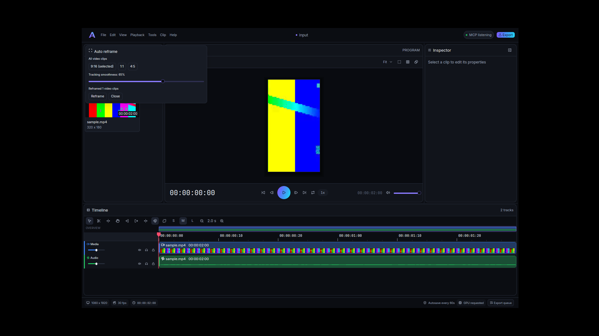

## Automatic subtitles

CapCut-style captions, fully local: **Clip, Generate subtitles…** transcribes the project's
audio (or the selected clip, or the in/out range) with Whisper and adds the result as
caption-bar clips on a new `Subtitles` track, as one undo step; progress and cancel live in
a status-bar popover like the export queue. `animathio-cli transcribe talk.mp4 --srt
talk.srt`, the `auto_subtitles` / `export_subtitles` / `import_subtitles` MCP tools and SRT
or WebVTT import and export work the same way.

Captions can be animated CapCut-style from Whisper's per-word timings: **Classic bar**,
**Word highlight**, **Karaoke fill**, **Pop**, **One word at a time** and **Bold outline**
(big type with a thick outline, centred for 9:16). Pick one in the Generate dialog, or in the
inspector of a selected caption (it restyles every caption on the track as one undo step; font
size, colours, top/middle/bottom position and words per line included). On the command line
use `transcribe lesson.amio --style karaoke -o out.amio`; over MCP pass `style` to
`auto_subtitles` or call `set_caption_style` on existing captions.

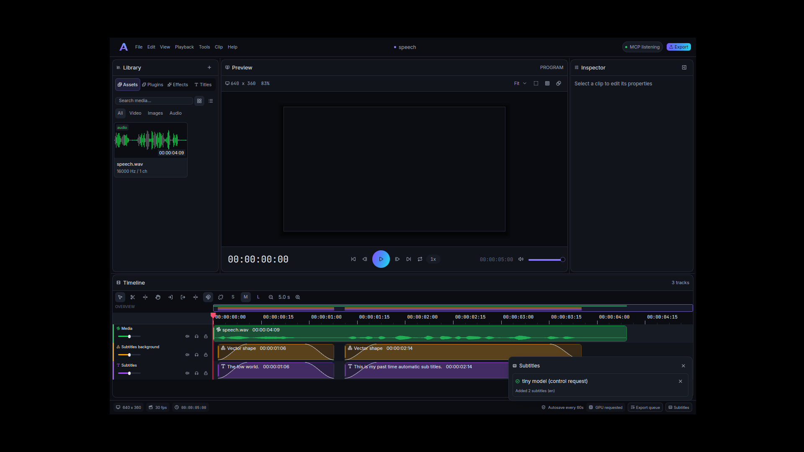

The speech engine is whisper.cpp, built only with `--features whisper` on `animathio`
and `animathio-cli` (needs cmake, a C++ compiler and libclang; the installers are built
with it). No model ships with the app: pick `tiny` (78 MB), `base` (148 MB, default) or
`small` (488 MB) and AniMathIO downloads it once on your confirmation, verifies its SHA-256 and
stores it in the user data directory. The opt-in integration test runs the real tiny model:
`cargo test -p animathio-transcribe --features whisper --test whisper_tiny -- --ignored`.

## Screenshot

The DaVinci-style editor shell on the `v2` branch (dark theme, media pool, viewer
with transport controls, resizable inspector and vertically scrolling timeline):

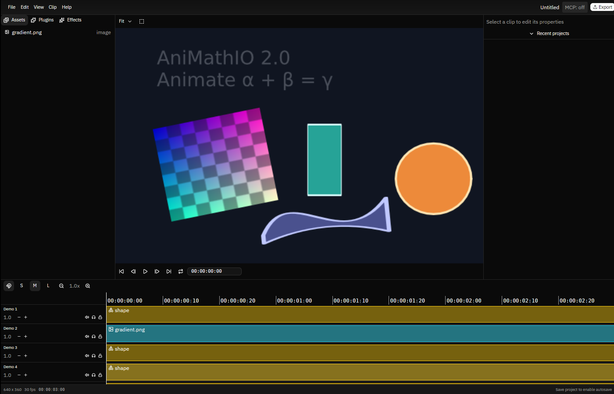

| Start screen | Export |
| --- | --- |
| 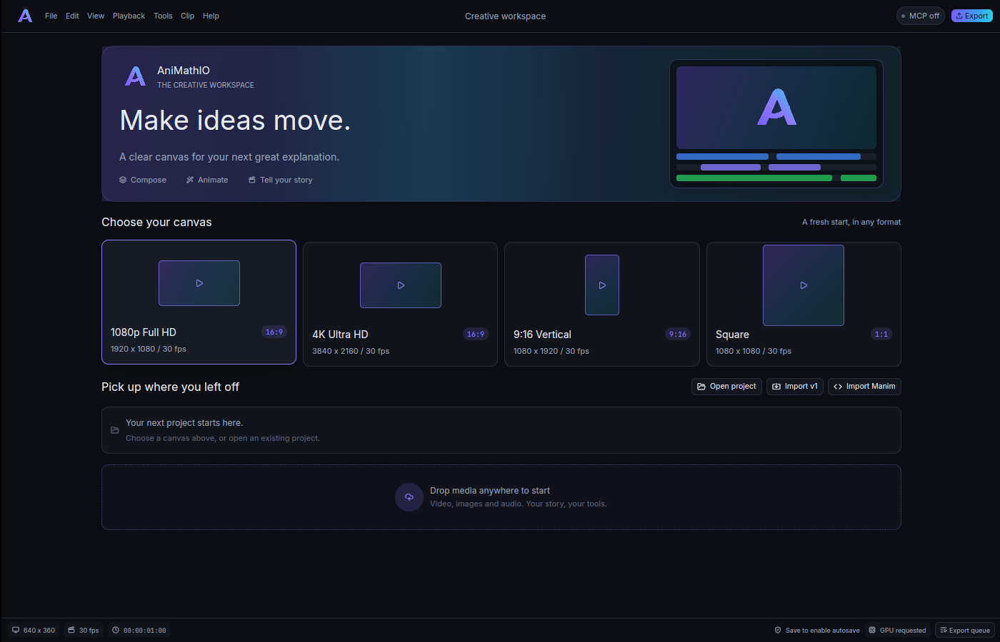 | 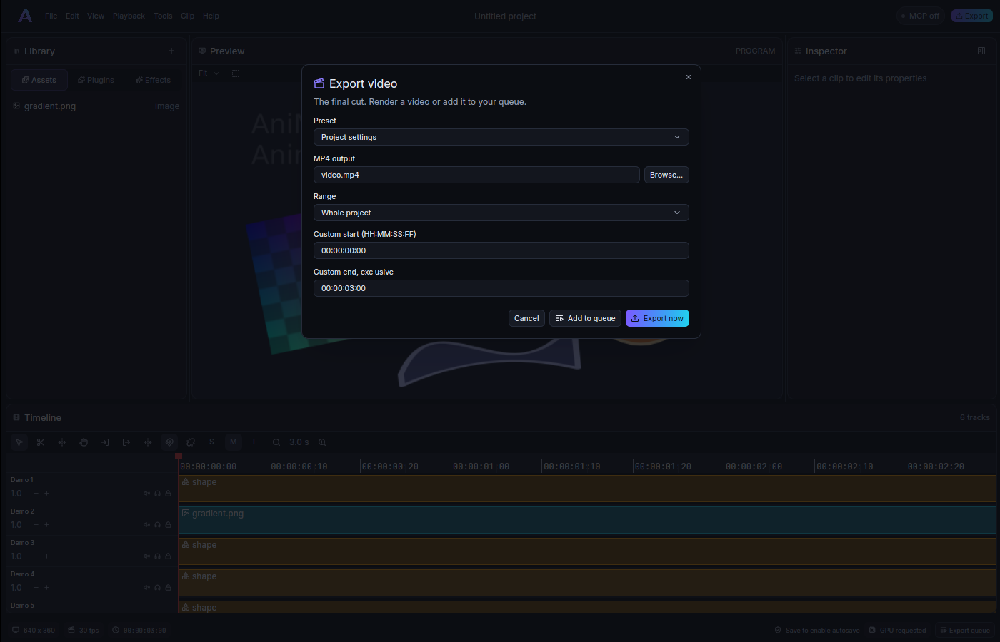 |

| Viewer and inspector | Timeline |
| --- | --- |
| 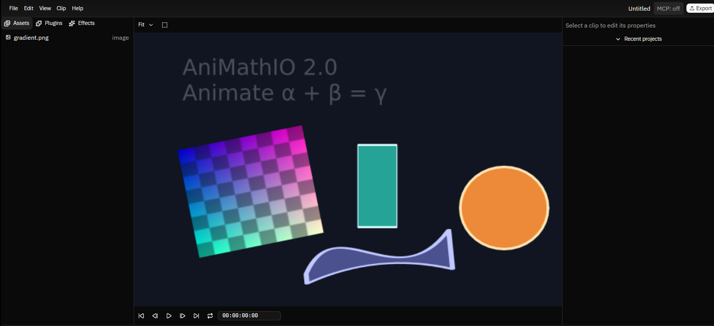 | 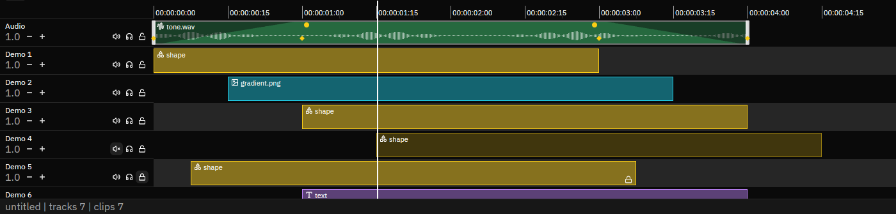 |

| Multi-selection (rubber band, inspector summary) | Media pool (thumbnail grid) |
| --- | --- |
| 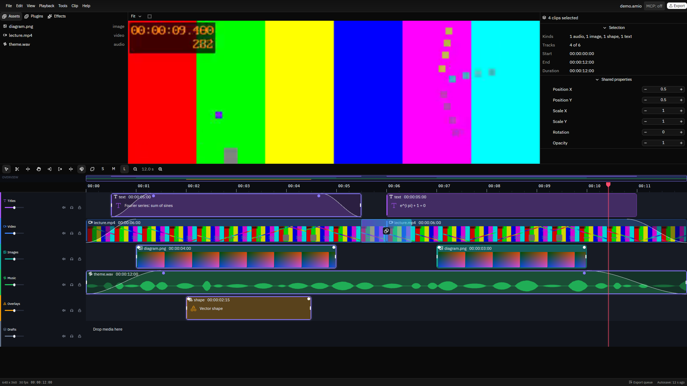 | 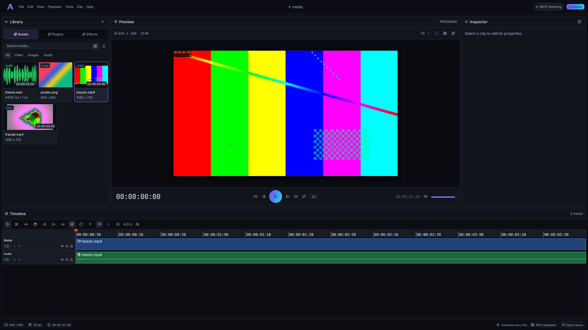 |

| Titles tab and a lower third (inspector text fields) | Export queue (status-bar popover) |
| --- | --- |
| 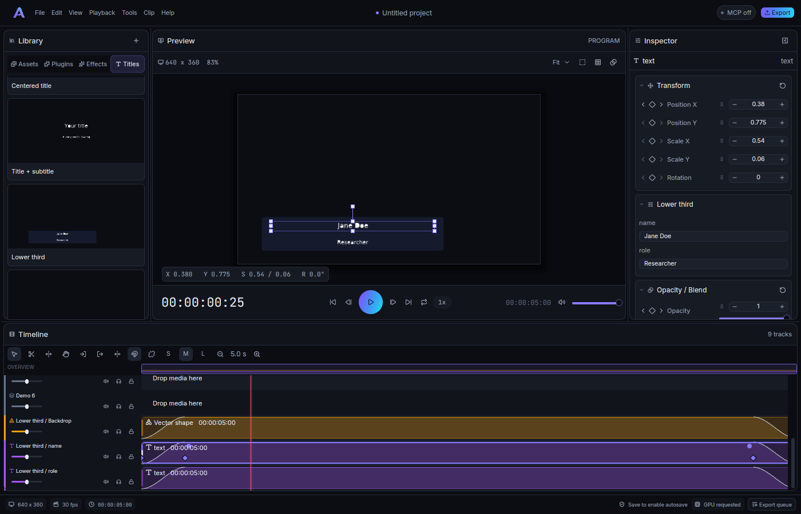 | 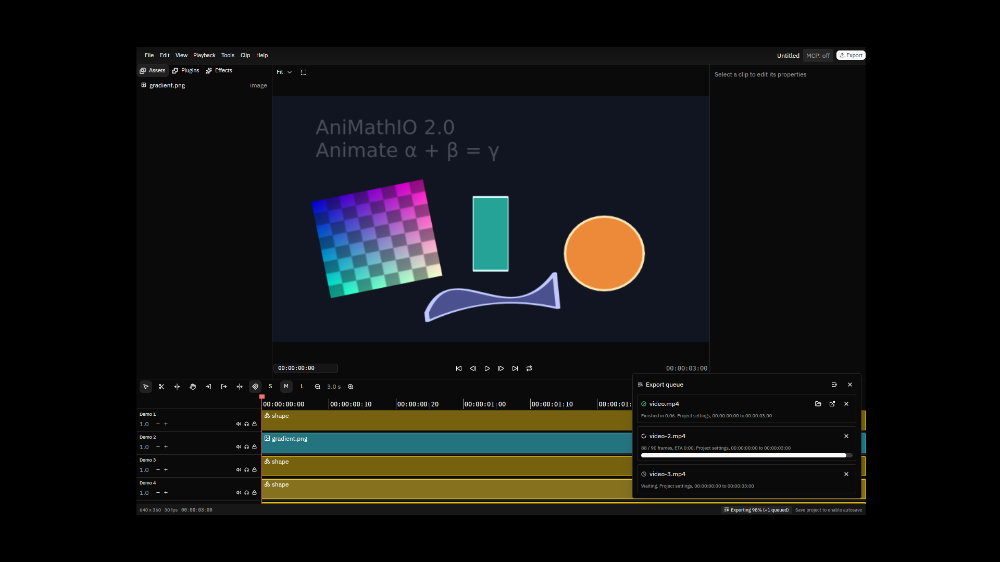 |

| Missing effect plugin warning (badge, inspector row, toast) |
| --- |
| 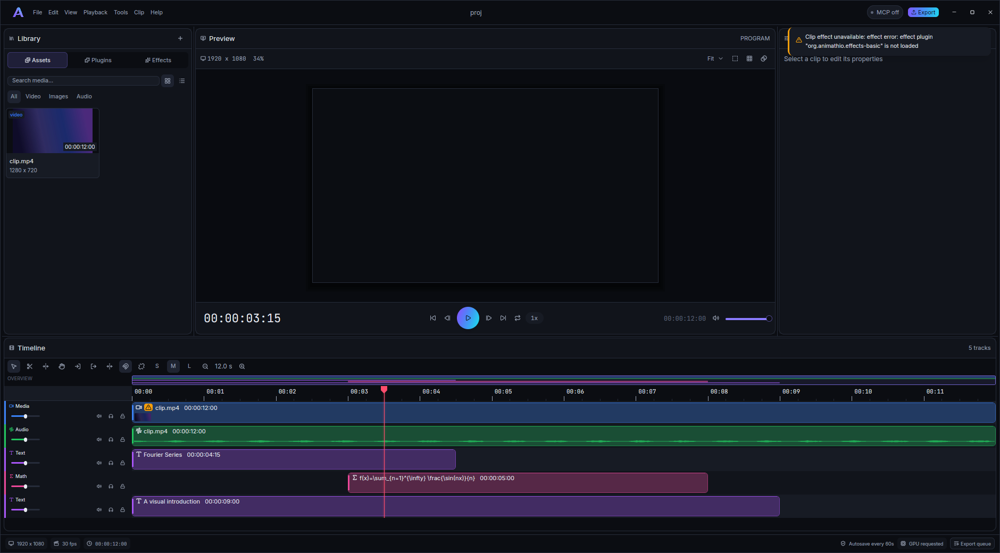 |

## Documentation

- [`docs/architecture.md`](docs/architecture.md) — crate map, time model, engine rules and data flow
- [`docs/plugins.md`](docs/plugins.md) — plugin authoring guide
- [`docs/cli.md`](docs/cli.md) — every `animathio-cli` subcommand
- [`docs/mcp.md`](docs/mcp.md) — control protocol and MCP tool surface
- [`docs/migrating-from-v1.md`](docs/migrating-from-v1.md) — what maps from 1.x and what doesn't
- [`docs/design.md`](docs/design.md) — visual design tokens and UI rules
- [`docs/release-checklist.md`](docs/release-checklist.md) — what is left before the 2.0 swap

## Installing

There is no published 2.0 release yet. Until `v2.0.0` is tagged, get an installer from the
`Package` workflow (Actions tab, run on `v2`, artifacts `installers-linux`, `installers-windows`
and `installers-macos`), or build from source below. Each installer ships both `animathio` and
`animathio-cli` plus the first-party plugins:

| Platform | Artifact | Notes |
| --- | --- | --- |
| Linux | `animathio_<version>_<arch>.AppImage` | the host provides the runtime libraries |
| Linux (Debian/Ubuntu) | `animathio_<version>_amd64.deb` | declares its runtime libraries as dependencies |
| Windows | `animathio_<version>_x64-setup.exe` | NSIS installer, unsigned (SmartScreen warns) |
| macOS | `AniMathIO_<version>_<arch>.dmg` | unsigned and not notarized: right-click, Open |

Verify with `animathio --version` and `animathio-cli --version`. Provenance of CI-built
installers is attested with `actions/attest-build-provenance`
(`gh attestation verify <file> --repo AniMathIO/AniMathIO`).

## Building

Stable Rust (edition 2024). On shared Linux machines keep the resource limits shown
below; on other platforms run the same Cargo commands directly. Linux builds also
need `libasound2-dev` (CI installs it) for the audio crate.

Build the bundled WASM components before rendering text or shapes:

```bash
scripts/build-plugins.sh
```

Debug binaries discover `target/plugins` relative to the executable. For an
unpackaged release binary, set `ANIMATHIO_PLUGIN_DIR=target/plugins` explicitly.
Installed packages discover the components in their bundled resource directories.

### The desktop editor

```bash
cargo run -p animathio                 # start screen with presets and recent projects
cargo run -p animathio -- --sample     # open the shared sample project
cargo run -p animathio -- file.amio    # open a project
cargo run -p animathio -- --control    # also start the control socket (see docs/mcp.md)
```

The preview renders on the GPU (Vello on wgpu) when an adapter is available and
falls back to the CPU reference otherwise. Toggle it with **View → GPU preview**
(persisted), or force it for one run with `ANIMATHIO_RENDER=cpu` or `ANIMATHIO_RENDER=gpu`.
Export always uses the CPU renderer.

The editor is a thin GPUI shell over the command-only core. Playback, timeline
editing, generated plugin controls and the control socket share the same model.

The title bar provides File/Edit/View/Playback/Tools/Clip/Help menus, project status, the control
socket badge and Export. Drag panel dividers to resize; View toggles panel visibility.
The layout and S/M/L timeline track heights persist between sessions.

Use Ctrl (Cmd on macOS) with N/O/S/I/M for New/Open/Save/Import/Export and Z or
Shift+Z for Undo/Redo. In the timeline, Ctrl/Cmd+B splits the selected clips at the
playhead and Delete removes the selection; Shift+Delete ripple-deletes it (or the in/out
range across all tracks when no clip is selected). Space, Left/Right, Up/Down
and Home/End control playback, frame stepping, edit-point stepping and project bounds.
J/K/L shuttle backward/stop/forward; repeated J/L doubles the speed up to 16x. Holding K
while pressing J or L jogs at half speed. Audio follows the shuttle and stays the master
clock: forward 1x/2x/4x/8x and reverse 1x/2x/4x are audible (varispeed, so pitch follows
speed); faster rates are muted while video keeps pace.

**Selection and clipboard.** Click selects a clip; Ctrl/Cmd+click toggles it, Shift+click
adds the clips between it and the last-selected clip on the same track, and dragging a
rubber band over empty track space (Shift/Ctrl extends the selection) selects every
clip it touches. Ctrl/Cmd+A selects all, Esc clears (and first cancels a drag, menu or
rename). The inspector shows the clip count, kinds, tracks and time span, and its
Transform fields (plus Gain for all-audio selections) edit every selected clip at once.
Dragging, nudging (Left/Right = 1 frame, Shift+Left/Right = 10 frames while the timeline
has a selection; without one they move the playhead), deleting and splitting act on the
whole selection as one undo step. Ctrl/Cmd+C/X copy/cut, Ctrl/Cmd+V pastes at the playhead
on the original tracks (a missing, locked or occupied track gets a new one, so a paste
never overwrites), and Ctrl/Cmd+D duplicates the selection right after itself. The clip
JSON is also written to the system clipboard, so it can be pasted into another project
window.

**Viewer, inspector and media pool.** The selected visual clip shows an on-canvas
transform gizmo: drag inside to move (snapping to the canvas centre and edges, with
accent guide lines), drag a corner or edge handle to scale (Shift keeps the aspect
ratio), drag the handle above the box to rotate (Shift snaps to 15 degrees). A small
pill shows the live values. A drag previews without touching the history and lands as
one undo step on release. The viewer header has the zoom menu, safe-area, rule-of-thirds
and checkerboard toggles. The transport shows a large timecode (click it to type one),
prev/next edit, frame step, the circular play button, loop, the shuttle-speed badge,
the duration and a monitor-only volume (it never changes export). Inspector sections are
collapsible cards with a reset button each. Drag a field label (Shift = fine, Ctrl =
coarse) or the grip beside a value to scrub it as one undo step; 0 to 1 parameters also get a slider;
every animatable property has a keyframe diamond with previous/next-key arrows. The
media pool offers a grid or list, a search field, kind filter chips, per-card type
badges, duration and resolution, audio waveforms, and hover-scrubbing of video posters.

**Tracks.** Double-click a track name to rename it inline (Enter commits, Esc cancels).
Drag a track header onto another to reorder, or use the header's right-click menu
(Rename, Move up, Move down).

**Ripple.** The toolbar link button (Tools → Ripple all tracks) switches ripple edits
between "this track only" (default) and "all tracks". With all tracks, ripple delete and
Ripple trim (T, or Ctrl+edge-drag) slide later clips on every unlocked track, never into
a neighbouring clip; locked tracks stay put.

I and O set in/out points (out is exclusive), Shift+I/O jumps to them, and Alt+X clears them. The ruler highlights
the range; looping uses it and export defaults to it. Select (A), Blade (B), Ripple
trim (T) and Hand/pan (H) are available in the timeline toolbar. Shift+blade-click
splits across tracks; Ctrl+edge-drag also ripple-trims. Ripple trim shifts later clips
on the same track as one undo step. N toggles snapping and an engaged snap draws an
accent line. Ctrl/Cmd+plus/minus zooms and Shift+Z fits the timeline.
Ctrl/Cmd+wheel smoothly zooms around the pointer; drag the overview above the
tracks to scroll. Clips show kind colours, video/image filmstrips, filled audio
waveforms, content snippets, smooth fade curves and gradient transition windows. Select a
clip to show its keyframe diamonds. Track headers have mute/solo/lock buttons and
a horizontal gain slider (drag to adjust, double-click to reset to unity); a drag
is one undo step. Use large tracks for the most detailed clip previews.

Export opens a form with an MP4 path chooser, whole/in-out/custom range and shared
`youtube_1080p`, `youtube_4k`, `shorts_vertical`, `square` and `portrait` presets (30 fps, CRF 18).
Presets apply to an export snapshot, keeping project settings unchanged. Existing
files require confirmation. Exports never block the editor: "Add to queue" or "Export now"
snapshots the project into a job, and the Export queue popover (status bar, View menu) runs
jobs one at a time with progress, ETA, cancel, show-in-folder/open and error text; toasts
announce completion or failure.
File → Project settings edits resolution, rational fps and background. Preferences
(Ctrl/Cmd+,) saves the preview renderer, autosave interval (0 disables), default export
folder and density in the application config directory, separately from projects.

Drop OS media files on the pool to import assets, or on a timeline track to import
and place them at that position. Multiple files are placed consecutively. The Plugins
tab's **Write on…** action replaces a selected LaTeX clip's reveal animation with
0-to-1 keyframes over a chosen duration, in one undo step. Help → Keyboard shortcuts
shows the registered bindings. Text fields support selection, paste and IME.

### Titles and social formats

The library's **Titles** tab offers eight animated compositions: centered title,
title + subtitle, lower third, caption bar, chapter card, end card, kinetic word
pop and math title. Double-click a card to add five seconds at the playhead, or
drag it to a timeline position. The inspector exposes the linked composition's
text fields. All layers move together and insertion undoes in one step.
Thumbnails render on the CPU in the background and are cached per canvas size.
Text/shapes plugins are required; math titles also need the LaTeX plugin.

The launcher, project settings and export dialog share 1080p, 4K, 9:16, square and
4:5 choices. MCP clients can use `list_title_presets` and `add_title` with `preset`
and `fields`; see [the control guide](docs/mcp.md#title-preset-library).

### The CLI

```bash
cargo build -p animathio-cli --locked
./target/debug/animathio-cli new-sample -o sample.amio
./target/debug/animathio-cli validate sample.amio
./target/debug/animathio-cli render sample.amio --frame 30 -o frame.png
./target/debug/animathio-cli render sample.amio --time 1.25 --width 1280 --height 720 -o timed.png
./target/debug/animathio-cli render-seq sample.amio --from 0 --to 90 -o frames/
```

`--frame`, `--from` and `--to` use zero-based project frame indices; sequence end is
exclusive. `--time` accepts exact decimal seconds or integer ticks with a `ticks`
suffix (705,600,000 ticks/second). Output uses the project's canvas size (640×360 when
it is unset); `--width`/`--height` override it. See [`docs/cli.md`](docs/cli.md)
for the full reference, including `export`, `import-media` and `mcp`.

## Importing projects

Convert a v1 (Electron/TypeScript) `.animathio` project to a 2.0 `.amio` archive:

```bash
./target/debug/animathio-cli import-v1 project.animathio -o imported.amio
```

Convert a Manim Community scene script to a `.amio` archive:

```bash
./target/debug/animathio-cli import-manim scene.py -o imported.amio
./target/debug/animathio-cli import-manim scene.py --scene MyScene -o imported.amio
```

Both importers rebuild the project exclusively through `Command`s and print
non-fatal warnings to stderr. What maps and what doesn't is documented in
[`docs/migrating-from-v1.md`](docs/migrating-from-v1.md).

Video imports include a linked companion audio clip when the file contains audio. Linked clips move, trim, split and delete together; use **Unlink** in the clip context menu to edit them independently. Headless import is available through MCP `add_media` or `animathio-cli import-media INPUT -o OUTPUT.amio`.

## Contributing

Pull requests for 2.0 target **`v2`**, not `main` or `staging`. When 2.0 ships, this branch is merged into `main` and 1.x moves to a read-only `legacy` branch. See [`CONTRIBUTING.md`](CONTRIBUTING.md) for the workflow and `AGENTS.md` for branch rules, automation and commands. Report vulnerabilities privately as described in [`SECURITY.md`](SECURITY.md).

## License

[MIT](LICENSE)

Timeline markers and beat sync: press M to drop a coloured marker on the ruler at the
playhead (Shift+M / Ctrl+Shift+M, or Cmd+Shift+M on macOS, jump to the next / previous
marker). Double-click a flag to edit its name, colour and note, drag it to move it
(markers snap, and clips and the playhead snap to markers). Clip > Markers and beat
sync opens a panel that lists the markers, detects the tempo and beats of the project
audio (or the selected clip) offline, adds markers at every beat, every Nth beat or the
downbeats, and snaps the selected clips' cut points to beats and markers or splits
them there, each as one undo step. The same actions are `animathio-cli markers` /
`animathio-cli beats` and MCP `list_markers`, `add_marker`, `remove_marker`,
`detect_beats` and `sync_cuts_to_beats`; see the [CLI reference](docs/cli.md#beats)
and [MCP reference](docs/mcp.md#markers-and-beat-sync).

Automatic cuts for recordings are available through Clip > Automatic cuts,
`animathio-cli autocut`, and MCP `propose_autocuts` / `apply_autocuts`. Review silence
ranges on the timeline before applying one undoable linked audio/video ripple edit.
Optional local Whisper adds filler-phrase and immediate-repeat suggestions; see the
[CLI reference](docs/cli.md#autocut) and [review rules](docs/mcp.md#automatic-cut-review).

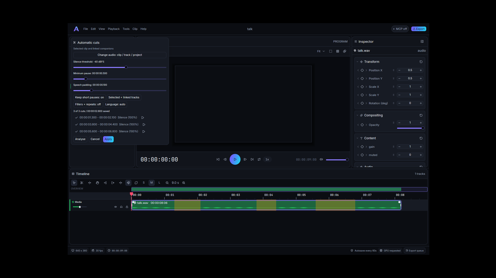

The launcher lists five bundled project templates and saved user templates, with CPU
thumbnail cards. Creating one opens Fill placeholders for text and picked media;
media supports cover/contain and replacement is one undoable batch. File > Save as
template stores the current project and selected placeholder clips in the user data
library; user cards have Delete. The CLI keeps `templates list` and
`new --template quote -o quote.amio`; MCP adds `list_templates` and
`create_from_template`. Template card hover lifts use the shared surface tokens.
