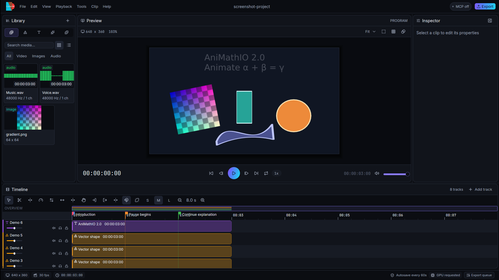
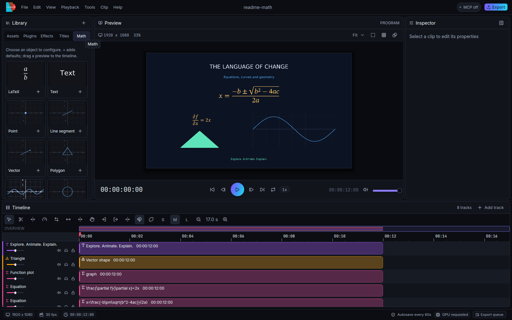
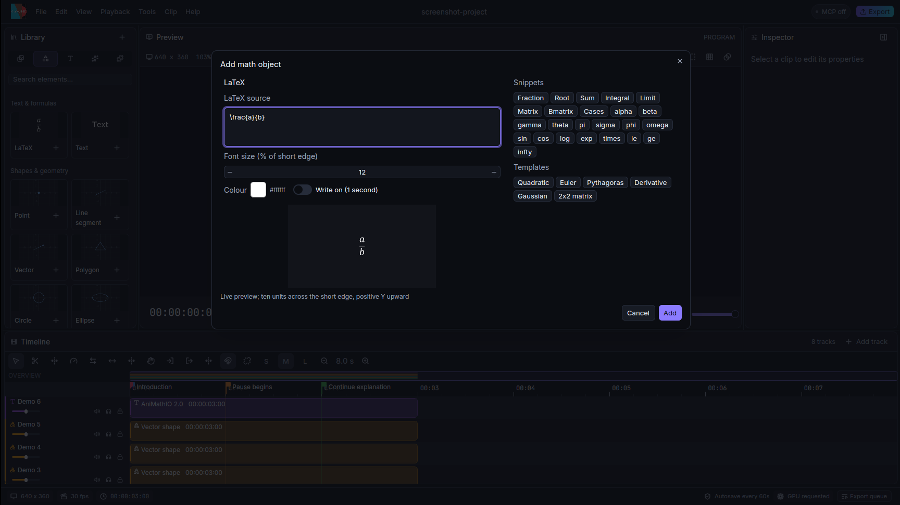

# AniMathIO 2

AniMathIO is a desktop editor for math animation videos. Combine media, editable
LaTeX, graphs and shapes on a multi-track timeline, then export a video. AniMathIO 2
rebuilds the editor and rendering engine in Rust.



Clip speed edits offer **Maintain pitch** audio time stretching in preview and
export. New clips enable it; existing projects preserve their previous sound.
Video above 1x speed is box filtered over time, and speed ramps have draggable
handles on the timeline.

## Installing

Download the installers from the [latest release](https://github.com/AniMathIO/AniMathIO/releases/latest).
Visit [docs.animathio.com](https://docs.animathio.com) for documentation.

Linux packages include AppImage and deb; Windows uses an NSIS installer and macOS
a disk image. Installers bundle the CLI and first-party plugins. Windows and macOS
installers are unsigned; Windows may show SmartScreen, and macOS requires
right-click → Open. Verify installation with `animathio --version` and
`animathio-cli --version`.

## Highlights

- Edit with multiple tracks, keyframes, undo/redo, linked audio and video, and
  familiar keyboard shortcuts.
- Typeset LaTeX and animate graphs and geometric shapes with bundled plugins.
- Record narration from a microphone straight into the Media library (opt-in per take;
  the audio is a normal WAV asset, and adding it to the timeline is one undo step).
- Add titles and captions, review automatic cuts, and reframe video for social formats.
- Render and export through the same engine used by the editor, to MP4 (H.264 + AAC) or WebM (VP9 + Opus).
- Once a day the editor checks GitHub for a newer release and shows a notice with a link
  to it; opt out in Preferences or with `ANIMATHIO_NO_UPDATE_CHECK=1` (no telemetry, no
  automatic download).





The Rust engine is faster than 1.x in the measured workloads; see the
[benchmarks and their caveats](docs/benchmarks.md).

See the [editor guide](docs/editor-guide.md) for workflows and more screenshots,
and [keyboard shortcuts](docs/keyboard-shortcuts.md) for editing controls.

## Building

Use stable Rust (edition 2024). Linux also needs `libasound2-dev`; see
[contributing](CONTRIBUTING.md) for development checks and dependencies.
Build the first-party plugins before launching:

```bash
scripts/build-plugins.sh
CARGO_BUILD_JOBS=3 CARGO_PROFILE_DEV_DEBUG=line-tables-only nice -n 19 ionice -c3 cargo build --release -p animathio -p animathio-cli --locked
ANIMATHIO_PLUGIN_DIR=target/plugins ./target/release/animathio
```

For local speech recognition, build with `--features whisper` (cmake, a C++
compiler and libclang required). Models download on demand with confirmation.

## Documentation

- [CLI reference](docs/cli.md) — headless project creation, rendering and export.
- [MCP and control protocol](docs/mcp.md) — automate editing from an assistant.
- [Plugin authoring and community plugins](docs/plugins.md) — sandboxed WebAssembly extensions, and installing third-party plugins (off by default, enabled one by one); start from the [plugin template, examples and community index](https://github.com/AniMathIO/plugins).
- [Architecture](docs/architecture.md) — crate map, time model and engine rules.
- [Migrating from 1.x](docs/migrating-from-v1.md) — import projects and known gaps.
- [Math showcases](examples/showcase/README.md) — reproducible offline explainers.

The frozen Electron implementation remains on the
[`legacy` branch](https://github.com/AniMathIO/AniMathIO/tree/legacy).
The rewrite's roadmap is recorded in [issue #156](https://github.com/AniMathIO/AniMathIO/issues/156).

## Contributing

Pull requests target `main`. Read [CONTRIBUTING.md](CONTRIBUTING.md) and
[AGENTS.md](AGENTS.md) for the workflow and repository rules.
Report vulnerabilities privately following [SECURITY.md](SECURITY.md).

## License

[MIT](LICENSE)

Linux Flatpak build and installation instructions: [Flatpak](docs/flatpak.md) (Flathub submission pending).
