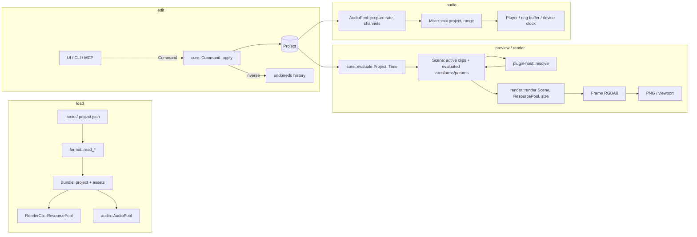

# Architecture

This document describes the 2.0 crate map, the layering rules, the time model and
the render/audio/export data flow. The authority for these rules is
[issue #156](https://github.com/AniMathIO/AniMathIO/issues/156).

## Crate map

| Crate | Owns |
| --- | --- |
| `core` | Plain project data (`Project`, `Track`, `Clip`, `ClipKind`, `Transform`, `Animation`), exact timeline arithmetic (`Time`, `FrameRate`), the `Command` mutation API with undo/redo, and pure `evaluate(&Project, Time) -> Scene`. **No IO, GPU, decoder or UI dependencies.** |
| `format` | Versioned `project.json` (schema version 1) and content-addressed `.amio` ZIP containers. Reader/writer APIs leave filesystem policy (atomic replace, autosave) to callers. |
| `render` | Deterministic, GPU-free Vello CPU backend, embedded font shaping, the engine `ResourcePool`, `Frame` (RGBA8), PNG encoding and PNG/JPEG decoding. Also the shared `sample` demo project. |
| `audio` | Engine-owned decoded PCM pools, immutable resampled mixer snapshots, and cpal/rtrb device playback. No audio resources live in `Project`. |
| `control` | Local JSON-RPC 2.0 control protocol over a user-only socket/named pipe: methods, token auth, headless handler and client. |
| `plugin-api` | The WIT world (`crates/plugin-api/wit/plugin.wit`), the `plugin.toml` manifest format, `.amplugin` package (zip of `plugin.toml` + `plugin.wasm`), the inspector schema and the guest SDK. |
| `plugin-host` | wasmtime Component Model runtime: loading/compiling plugins, the sandbox (fuel, epoch, memory, output caps), host imports (shape-text, svg-to-paths, typeset-math, log) and plugin scene resolution. |
| `typeset` | Host-side math typesetting: Typst as a library plus MiTeX for LaTeX→Typst conversion, turned into vector path outlines plus a tight bbox. |
| `import-v1` | One-way importer for v1 `.animathio` projects (deflated JSON + base64 media). |
| `import-manim` | One-way importer for Manim Community scene scripts (`.py`), parsed with tree-sitter. |
| `apps/animathio-cli` | Headless validation, PNG rendering, importers and the MCP sidecar. |
| `apps/animathio` | The GPUI desktop editor: a thin view over the command-only core. |
| `plugins/*` | Standalone first-party WebAssembly plugins: `shapes`, `text`, `latex`, `graph`, `trap` (sandbox fixture), and `examples/hello`. |

`media` (FilmCraft decode + MP4/WebM export) is planned but not yet integrated;
video clips currently render a labelled checkerboard placeholder.

## Layering

Dependencies point inward. The core owns its domain types and exposes no
`&mut` outside command application; the UI and control layers change state only
through `Command`s.

```text
                       apps/animathio (GPUI editor)
                       apps/animathio-cli (headless + MCP)
                                    │
                         control (JSON-RPC + MCP)
                          │    │       │
              ┌───────────┘    │       └──────────────┐
              ▼                ▼                      ▼
   import-v1 / import-manim   render                audio
              │                │                      │
              └────────┬───────┴──────────┬───────────┘
                       ▼                  ▼
                    format           plugin-host ── plugin-api (WIT/SDK)
                       │                  │  └── typeset
                       └────────┬─────────┘
                                ▼
                              core
```

Rules that keep the layers honest:

- `core` has no IO/GPU/decoder deps. `Project` contains no runtime resources.
- `format`, `render`, `audio`, `import-v1`, `import-manim`, `control` and
  `plugin-host` all depend on `core` and never the reverse.
- `control` sits above `format`/`render`/`import-v1` so the MCP sidecar can load,
  mutate, render and import headlessly without the editor.
- Third-party crates (FilmCraft, vello, GPUI) stay behind adapter boundaries;
  no third-party type leaks into `core`.

## Time model (integer ticks)

AniMathIO 2.0 uses **integer ticks** at a fixed rate, with **rational frame rates**
on top. The rate is 705,600,000 ticks per second — the *flicks* constant, chosen so
frame and audio-sample boundaries are always exact:

```text
TICKS_PER_SECOND = 705_600_000
```

It is divisible by 24, 25, 30, 50, 60, 120, the NTSC numerators 24000/30000/60000/
120000 (so 23.976, 29.97, 59.94 and 119.88 fps are exact), and the audio rates
44100/48000/96000/192000. An `i64` of ticks still spans over 400 years in either
direction. Code and CLI flags call the unit "ticks"; the underlying rate is the
flicks rate.

- `Time(i64)` — a signed tick position. Negative values are allowed for intermediate math.
- `FrameRate { numerator, denominator }` — a positive, reduced rational rate.
  `frame_to_time(frame, rounding)` and `time_to_frame(time, rounding)` convert with
  an explicit `Rounding` policy (`Floor`, `Ceil`, `Nearest`) so rational frame
  boundaries that fall between ticks are never silently rounded.
- `TimeRange { start, end }` — a half-open `[start, end)` nonnegative interval.

The `core` model stores no `f64` seconds and no absolute pixels. `Transform` is
resolution-independent (position/scale are fractions of the canvas, rotation is
radians, opacity is `[0, 1]`). Pixel conversion happens only at the render/UI
boundary.

## Engine rules from #156

Each rule exists because of a specific v1 failure, and each is enforced by a test.

| v1 failure | 2.0 rule | Enforced by |
| --- | --- | --- |
| Live Konva nodes, `<video>`/`<audio>` elements and `AudioContext` source nodes stored next to project data; leaked contexts and silent preview after export. | **The project is plain data.** Decoders, GPU textures and audio streams live in an engine-owned resource pool keyed by asset hash. Removing a clip never has to release anything. | `core` has no IO/GPU deps; after deleting every clip and running GC the pool is empty. |
| Animations in a separate anime.js timeline seeked in parallel with the store. | **Animated values are always computed from (project, t)** and never kept in a second stateful object. Keyframes are data. | Property test: rendering at `t` is independent of which times were rendered or seeked before. |
| Playback on `Date.now()` + rAF while each media element kept its own clock. | **One clock: the audio device clock.** Video asks "which frame is due now?" and is never corrected after drifting. No `f64` seconds anywhere. | Exported A/V offset is within ±½ frame across the sample corpus. |
| Export recorded the canvas in real time, so every playback bug ended up in the file. | **Export steps the same render path frame by frame.** Never a recording, never tied to the wall clock. | Golden tests: export frame N equals preview frame N. |
| ~98 forwarded store members; any component could change anything. | **Each piece of state has exactly one owner.** The UI holds only view state and changes the engine only through `Command`s. | `ui` depends on `core`'s public API only; `core` types expose no `&mut` outside command application. |

## Commands

`core::Command` is an exhaustive enum of serializable, invertible edits:
`AddTrack`, `RemoveTrack`, `SetTrackGain`, `AddAsset`, `RemoveAsset`,
`SetSettings`, `AddClip`, `RemoveClip`, `MoveClip`, `TrimClip`, `SplitClip`,
`MergeClip`, `SetTransform`, `SetParam`, `AddEffect`, `RemoveEffect`,
`SetEffectParam`, `AddKeyframe`, `RemoveKeyframe`.

`Command::apply(&mut Project) -> Result<Command>` validates the candidate project
transactionally and returns the exact inverse, so undo/redo, the control protocol,
MCP and plugins all funnel through one API. A failed edit leaves the project
unchanged.

## Data flow



- **Load.** `format::read_amio`/`read_json` produce a `Bundle` (validated `Project`
  plus content-addressed asset bytes keyed by BLAKE3). The CLI moves asset bytes
  into `RenderCtx::ResourcePool`; the editor additionally feeds `audio::AudioPool`.
- **Edit.** Every mutation is a `Command::apply`. `Project` stays plain data;
  nothing evaluated is cached inside it.
- **Evaluate.** `core::evaluate(&Project, Time)` selects the active clips
  (half-open ranges, back-to-front track order) and samples keyframes into a
  `Scene` of `SceneClip`s — transforms and numeric params resolved at that instant,
  independently of seek order.
- **Resolve plugins.** The plugin host replaces `ClipKind::Plugin` clips with
  `ClipKind::Vector` scenes by running the sandboxed component; missing/trapped
  plugins become `ClipKind::Error` without crashing the host. The headless CLI
  renders unresolved plugin clips as placeholders.
- **Render.** `render::render(&Scene, &mut RenderCtx, size)` rasterizes back-to-front
  with the Vello CPU backend into a tightly packed straight-alpha RGBA8 `Frame`
  (capped at 32 megapixels). The same call serves preview and frame-stepped export.
- **Audio.** `AudioPool::prepare(rate, channels)` decodes/resamples outside playback;
  `Mixer::mix(project, range)` produces immutable snapshots shared by preview and
  export; `Player` consumes the ring buffer and updates the latency-corrected
  master clock. The device callback only consumes the ring; `Player::now()` is
  quantized to callbacks and freezes on underflow.
- **Export.** Export steps the render path frame by frame (`render-seq` today;
  MP4/WebM export is pending the `media` crate). It is never a recording of playback.
