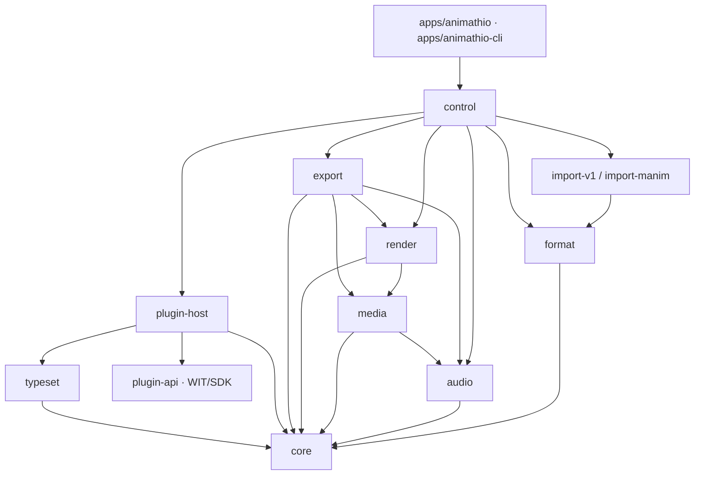

# Architecture

This document describes the 2.0 crate map, the layering rules, the time model and
the render/audio/export data flow. The authority for these rules is
[issue #156](https://github.com/AniMathIO/AniMathIO/issues/156).

## Crate map

| Crate | Owns |
| --- | --- |
| `core` | Plain project data (`Project`, `Track`, `Clip`, `ClipKind`, `Transform`, `Animation`), exact timeline arithmetic (`Time`, `FrameRate`), the `Command` mutation API with undo/redo, and pure `evaluate(&Project, Time) -> Scene`. **No IO, GPU, decoder or UI dependencies.** |
| `format` | Versioned `project.json` (schema version 2) and content-addressed `.amio` ZIP containers. Stream APIs support custom storage; filesystem save helpers validate and atomically replace targets using synced temporary files in the same directory. |
| `render` | Deterministic, GPU-free Vello CPU backend (the reference for tests and export), an optional `gpu` feature with a Vello/wgpu `GpuBackend` for preview, embedded font shaping, the engine `ResourcePool`, `Frame` (RGBA8), PNG encoding and PNG/JPEG decoding. Also the shared `sample` demo project and the `FrameSource` video seam. |
| `audio` | Engine-owned decoded PCM pools, immutable resampled mixer snapshots, and cpal/rtrb device playback. No audio resources live in `Project`. |
| `media` | FilmCraft decode behind the `MediaBackend` trait (probe, frame-exact video seek, audio PCM), an LRU-budgeted engine `MediaPool` with prefetch, and the H.264 + AAC `Mp4Encoder` (BT.709-tagged). Untrusted-input limits (dimensions, frame counts, rates, checked arithmetic) are enforced before codec work. |
| `export` | Deterministic offline MP4 export: steps `render(evaluate(project, t))` frame by frame plus the audio mixer, encoded with `Mp4Encoder`. Never a recording of playback. |
| `control` | Local JSON-RPC 2.0 control protocol over a user-only socket/named pipe: methods (including `export`), token auth, headless handler and client. |
| `plugin-api` | The WIT world (`crates/plugin-api/wit/plugin.wit`), the `plugin.toml` manifest format, `.amplugin` package (zip of `plugin.toml` + `plugin.wasm`), the inspector schema, guest SDK and first-party clip authoring helpers (`sources`). |
| `plugin-host` | wasmtime Component Model runtime: loading/compiling plugins, the sandbox (fuel, epoch, memory, output caps), host imports (shape-text, svg-to-paths, typeset-math, log) and plugin scene resolution. |
| `typeset` | Host-side math typesetting: Typst as a library plus MiTeX for LaTeX→Typst conversion, turned into vector path outlines plus a tight bbox. |
| `import-v1` | One-way importer for v1 `.animathio` projects (deflated JSON + base64 media). |
| `import-manim` | One-way importer for Manim Community scene scripts (`.py`), parsed with tree-sitter. |
| `apps/animathio-cli` | Headless validation, PNG rendering, MP4 export, importers and the MCP sidecar. |
| `apps/animathio` | The GPUI desktop editor: a thin view over the command-only core, plus an export worker and dialog. |
| `plugins/*` | Standalone first-party WebAssembly plugins: `shapes`, `text`, `latex`, `graph`, `trap` (sandbox fixture), and `examples/hello`. |

Video clips decode through `render::FrameSource` via the `media` crate's
`MediaPool`, so real video frames appear in preview, the CLI and headless
renders. `export` encodes MP4 (H.264 + AAC, BT.709-tagged) offline. WebM export
and an FFmpeg fallback backend remain future work; `MediaBackend` is shaped so a
second backend can be added without touching callers.

## Layering

Dependencies point inward. The core owns its domain types and exposes no
`&mut` outside command application; the UI and control layers change state only
through `Command`s.



`render` and `export` share `media`; `export` additionally uses `audio`'s mixer
and `render`'s rasterizer, and `media` reuses `audio`'s Symphonia decode for
non-indexed audio assets. Every crate bottoms out in `core`.

Rules that keep the layers honest:

- `core` has no IO/GPU/decoder deps. `Project` contains no runtime resources.
- `format`, `render`, `audio`, `media`, `export`, `import-v1`, `import-manim`,
  `control` and `plugin-host` all depend on `core` and never the reverse.
- `control` sits above `format`/`render`/`export`/`import-v1` so the MCP sidecar
  can load, mutate, render, export and import headlessly without the editor.
- Third-party crates (FilmCraft, vello, GPUI) stay behind adapter boundaries;
  no third-party type leaks into `core`.

## Desktop editor foundations

`apps/animathio/src/editor.rs` owns view state and composes implementation modules
under `editor/`: `menus`, `workspace`, `viewer`, `transport`, `timeline_view`,
`fields`, `inspector_view`, `media_pool`, `dialogs`, `commands`, `project_io`,
`control_bridge` and `playback_glue`. Shared drawing/resource helpers live in
`support`; `color_edit` owns the live-preview transaction. `editing.rs` holds pure
shuttle, in/out, blade and ripple command planning. In/out points and tool mode stay
in view state. Ripple trim uses one `Command::Batch` on the source track;
Shift+Delete uses `RippleDelete`. The ruler and export range share half-open bounds.
The audio device clock stays master at every shuttle speed; with no output device a signed
monotonic clock stands in.

Audible shuttle lives in `crates/audio` (`Speed`, `BlockGenerator`, `varispeed`).
`Player::set_speed` restarts the session at the latency-corrected position like a seek.
Timeline painting uses GPUI canvas quads/paths and culls clips before building
labels or requesting previews. A separate `timeline_thumbnails` worker decodes
five source-time samples per visible video clip, resizes them to low-resolution
BGRA tiles and repeats one tile for still images. Keys include asset, source time
and track height; the queue holds 16 requests and the UI retains at most 256 tiles.
The worker keeps at most eight video decoders and eight small still images.
Waveforms reuse the editor's cached 4096-peak audio summaries and a bounded cache
of 128 paint-ready paths, invalidated by clip geometry, zoom, scroll or window
position changes. These resources
never enter the project model. The overview uses only lightweight clip ranges;
zoom interpolates view state over the design token's 180ms motion duration.

The mixer worker (never the device callback) renders blocks: it mixes the timeline span a
block covers and resamples it by the signed rate with linear interpolation, carrying the
fractional position so blocks join seamlessly. Negative speeds read backwards, so the block
is the reversed PCM. Forward up to 8x and reverse up to 4x are audible (pitch follows
speed); faster rates push silence. The callback's clock is `origin + frames * speed`
computed with a rational speed (reverse counts down), so video stays exact at each rate.
Half-speed K+J/K+L jog uses `Speed::HALF`.

Exports run through `export_queue`: each job owns a project snapshot, jobs run sequentially
on the export worker (`crates/export` honours the cancel flag through its progress
callback and leaves no partial file), and the editor polls the queue to drive the Export
queue popover and toasts. Control-protocol exports appear in the same queue.

`start_screen` provides project presets, recents and importer entry points. Workflow
dialogs use gpui-component forms; export works on an immutable snapshot, so selecting
a delivery preset does not change the open project. `control::ExportPreset` is the
shared table for editor, CLI and MCP. Preferences persist under the application
config directory (`preferences.json`, renderer selection in `preview.json`) and
never enter project serialization.

The `actions` module registers GPUI actions and a contextual keymap (`Editor`,
`Timeline`, `Viewer`, `Inspector`, `MediaPool`). `secondary-` bindings are resolved
with GPUI's OS-aware loader: Cmd on macOS and Ctrl elsewhere. App menus and button
tooltips read hints from those bindings. Text and numeric inputs own their editing
keys, clipboard, selection and IME; timeline Delete/Space never intercept a focused
input. The Help menu opens the shortcut reference.

The workspace uses horizontal and vertical resizable panel groups. Sizes, visibility
and S/M/L track density (28/44/72 logical pixels) persist in `dock-layout.json` under
the application config directory. Older files default to medium tracks. Headers and
clips share a vertical scroll surface, so every track remains accessible. Wheel
scrolls vertically; Alt+wheel scrolls horizontally; Ctrl/Cmd+wheel zooms.

Chrome uses the active dark theme, a 12 px base and monospaced timecodes. A single
custom title bar hosts the application menus, project/dirty state, control-server
status and Export. The status bar contains project output settings, duration and
autosave age. Transient errors, information and successful work use typed
notifications hosted by `Root`.

A colour drag applies `Command`s for immediate preview. On pointer release, it
restores the original value with the inverse command and records the final command
once in `History`. Other commands and control calls finish a pending drag first,
so a colour change undoes in one step without swallowing adjacent edits. Asset
parameter selectors display names but commit asset identities (or `null` for None).

## Time model (integer ticks)

AniMathIO 2.0 uses **integer ticks** at a fixed rate, with **rational frame rates**
on top. The rate is 705,600,000 ticks per second — the *flicks* constant, chosen so
frame and audio-sample boundaries are always exact:

```text
TICKS_PER_SECOND = 705_600_000
```

It is divisible by 24, 25, 30, 50, 60, 120, the NTSC numerators 24000/30000/60000/
120000 (so 23.976, 29.97, 59.94 and 119.88 fps are exact), and the audio rates
44100/48000/96000/192000. An `i64` of ticks still spans over 400 years in either
direction. Code and CLI flags call the unit "ticks"; the underlying rate is the
flicks rate.

- `Time(i64)` — a signed tick position. Negative values are allowed for intermediate math.
- `FrameRate { numerator, denominator }` — a positive, reduced rational rate.
  `frame_to_time(frame, rounding)` and `time_to_frame(time, rounding)` convert with
  an explicit `Rounding` policy (`Floor`, `Ceil`, `Nearest`) so rational frame
  boundaries that fall between ticks are never silently rounded.
- `TimeRange { start, end }` — a half-open `[start, end)` nonnegative interval.

The `core` model stores no `f64` seconds and no absolute pixels. `Transform` is
resolution-independent (position/scale are fractions of the canvas, rotation is
radians, opacity is `[0, 1]`). Pixel conversion happens only at the render/UI
boundary.

## Engine rules from #156

Each rule exists because of a specific v1 failure, and each is enforced by a test.

| v1 failure | 2.0 rule | Enforced by |
| --- | --- | --- |
| Live Konva nodes, `<video>`/`<audio>` elements and `AudioContext` source nodes stored next to project data; leaked contexts and silent preview after export. | **The project is plain data.** Decoders, GPU textures and audio streams live in an engine-owned resource pool keyed by asset hash. Removing a clip never has to release anything. | `core` has no IO/GPU deps; after deleting every clip and running GC the pool is empty. |
| Animations in a separate anime.js timeline seeked in parallel with the store. | **Animated values are always computed from (project, t)** and never kept in a second stateful object. Keyframes are data. | Property test: rendering at `t` is independent of which times were rendered or seeked before. |
| Playback on `Date.now()` + rAF while each media element kept its own clock. | **One clock: the audio device clock.** Video asks "which frame is due now?" and is never corrected after drifting. No `f64` seconds anywhere. | Exported A/V offset is within ±½ frame across the sample corpus. |
| Export recorded the canvas in real time, so every playback bug ended up in the file. | **Export steps the same render path frame by frame.** Never a recording, never tied to the wall clock. | Golden tests: export frame N equals preview frame N. |
| ~98 forwarded store members; any component could change anything. | **Each piece of state has exactly one owner.** The UI holds only view state and changes the engine only through `Command`s. | `ui` depends on `core`'s public API only; `core` types expose no `&mut` outside command application. |

## Commands

`core::Command` is an exhaustive enum of serializable, invertible edits:
`AddTrack`, `RemoveTrack`, `SetTrackGain`, `SetTrackMuted`, `SetTrackSolo`,
`SetTrackLocked`, `RenameTrack`, `MoveTrack`, `AddAsset`, `RemoveAsset`,
`SetSettings`, `AddClip`, `RemoveClip`, `MoveClip`, `TrimClip`, `SplitClip`,
`MergeClip`, `SetTransform`, `SetParam`, `AddEffect`, `RemoveEffect`,
`SetEffectParam`, `SetPluginParam`, `AddKeyframe`, `RemoveKeyframe`, `MoveKeyframe`,
`AddTransition`, `RemoveTransition`, `SetTransitionDuration`, `Batch`, `SplitAt`,
`RemoveRange` and `RippleDelete`.

Track flags: a muted track is silent in the mixer and skipped by `evaluate`;
while any track is soloed only soloed tracks are mixed and rendered (solo beats
mute). A locked track rejects every clip-level edit (`AddClip`, `RemoveClip`,
`MoveClip`, `TrimClip`, `SplitClip`, `MergeClip`, transform/param/effect and
keyframe commands) in `Command::apply` itself, so the editor, the control
protocol and MCP all see the same `track N is locked` error; layer-level
commands (gain, mute, solo, lock) always work so a track can be unlocked.
`SplitAt`, `RemoveRange` and `RippleDelete` also refuse locked tracks.
`RenameTrack` and `MoveTrack { id, index }` (the track's position after the move) are
layer-level, so they work on locked tracks too. The editor's multi-clip edits (grouped
move, nudge, delete, paste, duplicate, linked ripple) are plain `Batch`es planned by the
window-free `selection`, `clipboard` and `ripple` modules of the app crate, so each is one
undo step and is replayable over the control protocol.
`Batch { commands }` applies its members atomically as one undo step
(at most 1024 members); fades are a `Batch` of `AddKeyframe`s on a
clip's `gain` (audio) or opacity (everything else).

`Command::apply(&mut Project) -> Result<Command>` validates the candidate project
transactionally and returns the exact inverse, so undo/redo, the control protocol,
MCP and plugins all funnel through one API. A failed edit leaves the project
unchanged.

## Transitions

Transitions live on the `Track` (`transitions`, serde default empty) and sit on the
edit point between two adjacent clips: `Transition { id, kind, duration, from, to }`
where `from.range.end == to.range.start`. This was chosen over per-clip
transition-in/out fields because one record per cut cannot disagree with itself
and clips stay non-overlapping in the model. The window `[cut - d/2, cut + d - d/2)`
is centred on the cut; `evaluate` extends the outgoing clip past its end and starts
the incoming clip early (its source time is clamped at zero), and both
`SceneClip`s carry the same `SceneTransition { id, kind, progress, role }`.

Validation requires both clips on the transition's track, adjacency, a positive
duration, one transition per cut, and that each clip covers the halves of the
transitions on both of its edges. Edits that break adjacency (move, trim, split,
remove) are rejected until the transition is removed.

The CPU backend renders both sides into canvas layers (effects and opacity
applied) and blends them: premultiplied linear mix for `CrossDissolve`, through an
opaque black/white frame for `DipToBlack`/`DipToWhite`, and rectangular clip
layers for `Wipe { direction }`. The audio mixer extends cross-dissolved audio clips
across the window with equal-power gains (`cos`/`sin` of `p·π/2`); other kinds keep
a hard audio cut, and an incoming clip without a source handle is silent before
its source start.

## Data flow

```mermaid
flowchart LR
    subgraph load["load"]
        A[.amio / project.json] --> B[format::read_*]
        B --> C[Bundle: project + assets]
        C --> D[RenderCtx::ResourcePool]
        C --> E[audio::AudioPool]
    end

    subgraph edit["edit"]
        F[UI / CLI / MCP] -->|Command| G[core::Command::apply]
        G --> H[(Project)]
        G -->|inverse| I[undo/redo history]
    end

    subgraph preview["preview / render"]
        H --> J[core::evaluate Project, Time]
        J --> K[Scene: active clips + evaluated transforms/params]
        K --> L[plugin-host::resolve]
        L --> K
        K --> M[render::render Scene, ResourcePool, size]
        M --> N[Frame RGBA8]
        N --> O[PNG / viewport]
    end

    subgraph audio["audio"]
        H --> P[AudioPool::prepare rate, channels]
        P --> Q[Mixer::mix project, range]
        Q --> R[Player / ring buffer / device clock]
    end

    subgraph export["export"]
        H --> S[export::Exporter::export]
        S --> T[render(evaluate(project, t)) per frame]
        S --> U[Mixer::mix per inter-frame block]
        T --> V[media::Mp4Encoder]
        U --> V
        V --> W[out.mp4]
    end
```

- **Load.** `format::read_amio`/`read_json` produce a `Bundle` (validated `Project`
  plus content-addressed asset bytes keyed by BLAKE3). The CLI moves asset bytes
  into `RenderCtx::ResourcePool`; the editor additionally feeds `audio::AudioPool`.
- **Edit.** Every mutation is a `Command::apply`. `Project` stays plain data;
  nothing evaluated is cached inside it.
- **Evaluate.** `core::evaluate(&Project, Time)` selects the active clips
  (half-open ranges, back-to-front track order) and samples keyframes into a
  `Scene` of `SceneClip`s — transforms and typed params resolved at that instant,
  independently of seek order.
- **Resolve plugins.** The plugin host replaces `ClipKind::Plugin` clips with
  `ClipKind::Vector` scenes by running the sandboxed component; missing/trapped
  plugins become `ClipKind::Error` without crashing the host. The headless CLI
  renders unresolved plugin clips as placeholders.
- **Render.** `render::render(&Scene, &mut RenderCtx, size)` rasterizes back-to-front
  with the Vello CPU backend into a tightly packed straight-alpha RGBA8 `Frame`
  (capped at 32 megapixels). The same call serves preview and frame-stepped export.
  Export and tests always use the CPU backend. The editor preview uses `GpuBackend`
  (Vello compute on a headless wgpu device, texture readback to RGBA8) when
  `preview_backend(BackendKind::Gpu)` finds an adapter, and falls back to CPU with the
  reason otherwise or when a GPU render fails. Clips with effects are rasterized and
  filtered on the CPU effect path and composited by the GPU backend as an image.
- **Audio.** `AudioPool::prepare(rate, channels)` decodes/resamples outside playback;
  `Mixer::mix(project, range)` produces immutable snapshots shared by preview and
  export; `Player` consumes the ring buffer and updates the latency-corrected
  master clock. The device callback only consumes the ring; `Player::now()` is
  quantized to callbacks and freezes on underflow.
- **Export.** Export steps the render path frame by frame —
  `render(evaluate(project, t))` per frame plus the audio mixer's snapshot for
  each inter-frame block — and encodes with `media::Mp4Encoder`. It is never a
  recording of playback.

## Typed parameter animation

`ParamValue` owns numbers (`f64`), linear-light straight-alpha RGBA colours
(`f32` channels in `[0, 1]`), resolution-independent 2D points, booleans, enum
choices, strings, and optional content-addressed asset references. `Clip::params`
and evaluated `SceneClip::params` contain typed values; each `Animation` stores
`Keyframes<ParamValue>`. Transform and built-in effect targets still require
numbers. Validation rejects nonfinite values, mixed-type curves, and curves whose
type differs from their typed base parameter. Plugin curves may also target an
implicit schema default without a stored base value.

Numbers, points, and colours support linear, smoothstep ease-in/out, and hold
interpolation. Colour RGB channels interpolate in linear light (not sRGB byte
space), with alpha interpolated separately. Booleans, enum choices, strings, and
asset references always hold, regardless of the outgoing interpolation setting.
Exact key times return their stored values, and sampling outside a curve clamps
to its endpoints.

Serde accepts legacy bare numeric base values and keyframe values as
`ParamValue::Number`; new saves use tagged variants. This is a compatible read
extension to schema version 1. Opaque `ClipKind::Plugin::params` is preserved
verbatim. `SetPluginParam` sets/removes typed overrides in `Clip::params`; removing
an override exposes the original opaque value. The plugin host merges evaluated
typed overrides over opaque defaults, inferring legacy JSON types from the declared
schema and preserving the variants of typed values, converting
linear-light colours to the plugin API's sRGB bytes. The cache hashes typed values
including their variants.

Every plugin inspector control has a keyframe diamond. Editing an animated
parameter updates the key at the playhead or inserts one there, preserving an
existing key's outgoing interpolation. Unanimated edits update base parameters.

## Text and shape sources

Text and shapes are `ClipKind::Plugin` sources with IDs `org.animathio.text` and
`org.animathio.shapes`. Their parameters and geometry belong to the components;
`core` has no builtin source variants or source-specific validation. The optional
Rust constructors in `plugin-api::sources` create ordinary plugin payloads.
The editor inspector reads their declared schemas and applies typed parameters
through commands. CLI PNG renders, sequences, MP4 exports and headless control
resolve evaluated scenes through the same plugin host as preview.

The generic vector interchange supports `Canvas` pixel coordinates and `Normalized`
unit-square coordinates. Normalized paths, strokes and text scale with the clip;
normalized text font size is relative to canvas height and is laid out with the
embedded font, wrapping and alignment shared by CPU and GPU. A renderer sees only
resolved vector drawing instructions, never text/shapes plugin IDs.

Schema 2 writes plugin clips. `format` migrates schema-1 builtin text, rectangles,
ellipses and arbitrary quadratic/cubic paths, preserving local stroke widths,
fill/outline transparency, transforms, source offsets, keyframes and effects.
Legacy domain types and their validation exist only in the format reader. Existing
plugin payloads remain opaque and untouched. Effects continue in `render::effects`.

Integration tests use `plugin-host`'s `test-support` feature to build text and shapes
for `wasm32-wasip2` with a shared target directory and resource limits. Subprocess
CLI tests receive an explicit bundle directory. CI builds bundles on both Linux
and Windows; the WASI target must be installed for local tests too.

Clips optionally carry a serialized `link_group`. Move, trim, split, delete and ripple-delete propagate to companions transactionally; split halves get separate groups. Undo uses `Command::Exact` to replay individual inverse edits without propagating them twice. `SetClipLink` changes membership; the editor Unlink menu action clears the whole group in one batch. Locked companion tracks reject the complete edit.
