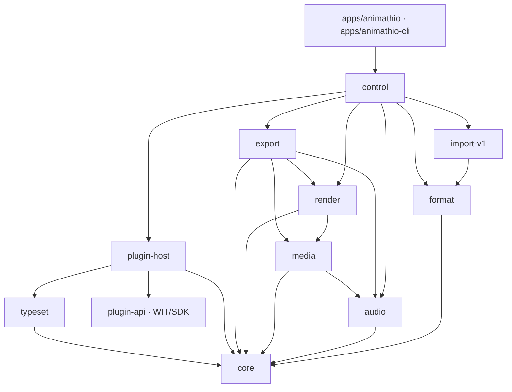

# Architecture

This document describes the 2.0 crate map, the layering rules, the time model and
the render/audio/export data flow. The authority for these rules is
[issue #156](https://github.com/AniMathIO/AniMathIO/issues/156).

## Crate map

| Crate | Owns |
| --- | --- |
| `core` | Plain project data (`Project`, `Track`, `Clip`, `ClipKind`, `Transform`, `Animation`), exact timeline arithmetic (`Time`, `FrameRate`), the `Command` mutation API with undo/redo, and pure `evaluate(&Project, Time) -> Scene`. Effects are plain data (`EffectInstance`: plugin id + effect id + numeric params); the `EffectProcessor` port is how the renderer asks a plugin host to run one. **No IO, GPU, decoder or UI dependencies.** |
| `format` | Versioned `project.json` (schema version 5) and content-addressed `.amio` ZIP containers. Stream APIs support custom storage; filesystem save helpers validate and atomically replace targets using synced temporary files in the same directory. |
| `render` | Deterministic, GPU-free Vello CPU backend (the reference for tests and export), the clip-effect chain mechanics (rasterize a clip layer, hand each effect to the context's `EffectProcessor`, composite), an optional `gpu` feature with a Vello/wgpu `GpuBackend` for preview, embedded font shaping, the engine `ResourcePool`, `Frame` (RGBA8), PNG encoding and PNG/JPEG decoding. Also the shared `sample` demo project and the `FrameSource` video seam. |
| `audio` | Engine-owned audio pools (one seekable `PcmReader` per asset; nothing holds a whole decoded asset), lazy block-wise resampling and channel mapping behind an LRU-budgeted cache, immutable mixer snapshots, Opus/Symphonia decoding, and cpal/rtrb device playback. No audio resources live in `Project`. Also pure offline beat detection (`detect_beats`). |
| `media` | FilmCraft decode behind the `MediaBackend` trait (probe, frame-exact video seek, audio PCM), an LRU-budgeted engine `MediaPool` with prefetch, and the H.264 + AAC `Mp4Encoder` (BT.709-tagged). Untrusted-input limits (dimensions, frame counts, rates, checked arithmetic) are enforced before codec work. |
| `export` | Deterministic offline MP4 export: steps `render(evaluate(project, t))` frame by frame plus the audio mixer, encoded with `Mp4Encoder`. Never a recording of playback. |
| `transcribe` | Local automatic subtitles: whisper.cpp speech recognition behind the opt-in `whisper` cargo feature (whisper.cpp through the whisper-rs bindings; needs cmake, a C++ toolchain and libclang), on-demand SHA-256-verified model downloads with resumable atomic writes, 16 kHz mono audio preparation on top of `audio`, pure cue splitting (line/duration/overlap rules) and SRT/WebVTT reading and writing. Everything but the engine works without the feature. |
| `control` | Local JSON-RPC 2.0 control protocol over a user-only socket/named pipe: methods (including `export`), token auth, headless handler and client. |
| `plugin-api` | The WIT world (`crates/plugin-api/wit/plugin.wit`), the `plugin.toml` manifest format, `.amplugin` package (zip of `plugin.toml` + `plugin.wasm`), the inspector schema, guest SDK and first-party clip authoring helpers (`sources`). |
| `plugin-host` | wasmtime Component Model runtime: loading/compiling plugins, the sandbox (fuel, epoch, memory, output caps), host imports (shape-text, svg-to-paths, typeset-math, limits, log, and `read-sibling` for importers), ABI 1.1.0 (1.0.0 components load unchanged) plus an explicit 0.2.x adapter, plugin scene resolution, pixel-effect plugins (`PluginHost::effects`, `effect_processor`: instance-pre cached components, a fresh fuel/memory/epoch-limited store per call, frame-size caps), animation presets (`PluginHost::animation_presets`, `animation_preset_command`) and importers (`PluginHost::importers`, `PluginHost::import`). |
| `typeset` | Host-side math typesetting: Typst as a library plus MiTeX for LaTeX→Typst conversion, turned into vector path outlines plus a tight bbox. |
| `import-v1` | One-way importer for v1 `.animathio` projects (deflated JSON + base64 media). Still native (see "Importers" below). |
| `import-manim` | One-way importer for Manim Community scene scripts (`.py`), parsed with a small pure-Rust Python parser (`pyparse`) whose node vocabulary follows tree-sitter-python. The app runs it only inside the `org.animathio.import-manim` importer plugin. |
| `apps/animathio-cli` | Headless validation, PNG rendering, MP4 export, importers and the MCP sidecar. |
| `apps/animathio` | The GPUI desktop editor: a thin view over the command-only core, plus an export worker and dialog. |
| `plugins/*` | Standalone first-party WebAssembly plugins: `shapes`, `text`, `latex`, `graph`, `effects-basic`, `audio-basic`, `animations` (animation presets), `import-manim` (Manim importer), `trap` (sandbox fixture), and `examples/hello`. |

Video clips decode through `render::FrameSource` via the `media` crate's
`MediaPool`, so real video frames appear in preview, the CLI and headless
renders. `export` encodes MP4 (H.264 + AAC, BT.709-tagged) offline. WebM export
and an FFmpeg fallback backend remain future work; `MediaBackend` is shaped so a
second backend can be added without touching callers.

## Layering

Dependencies point inward. The core owns its domain types and exposes no
`&mut` outside command application; the UI and control layers change state only
through `Command`s.



`render` and `export` share `media`; `export` additionally uses `audio`'s mixer
and `render`'s rasterizer, and `media` reuses `audio`'s Symphonia decode for
non-indexed audio assets. Every crate bottoms out in `core`.

Rules that keep the layers honest:

- `core` has no IO/GPU/decoder deps. `Project` contains no runtime resources.
- `format`, `render`, `audio`, `media`, `export`, `import-v1`, `import-manim`,
  `control` and `plugin-host` all depend on `core` and never the reverse.
- `control` sits above `format`/`render`/`export`/`import-v1` so the MCP sidecar
  can load, mutate, render, export and import headlessly without the editor.
  Manim import and animation presets reach `control` only through `plugin-host`;
  `import-manim` is compiled into the `plugins/import-manim` component, not linked
  into the apps.
- Third-party crates (FilmCraft, vello, GPUI) stay behind adapter boundaries;
  no third-party type leaks into `core`.

## Desktop editor foundations

`editor_env.rs` supplies production defaults and a headless test environment (monotonic
playback clock, CPU preview, built plugins or no plugins, private settings/cache paths).
`editor/ui_tests` mounts the real editor in gpui's test window and exercises actions and
shared panel handlers, asserting project and view state without devices or pixel snapshots.


`apps/animathio/src/editor.rs` owns view state and composes implementation modules
under `editor/`: `menus`, `workspace`, `viewer`, `transport`, `timeline_view`,
`fields`, `audio_effects` (inspector audio-effect cards), `animations` (the inspector
Animations section and the Effects-tab preset library), `video_effects` (inspector video-effect cards), `inspector_view`, `media_pool`, `titles` (Titles tab), `dialogs`, `export_panel`
(export queue popover), `start_screen`, `templates`, `clip_ops`, `commands`, `project_io`,
`control_bridge`, `playback_glue`, `timeline_thumbnails` and `actions`. Shared drawing/resource helpers live in
`support`; `color_edit` owns the live-preview transaction (colour pickers, sliders,
number scrubbing and the viewer's transform gizmo all preview through it, so one
gesture is one history entry). The gizmo maths in `viewer` shares the renderer's
canvas mapping and builds its edit with `inspector::transform_edit_commands`, which
merges plain properties into one `SetTransform` and keyframes animated ones. `editing.rs` holds pure
shuttle, in/out, blade and ripple command planning. In/out points and tool mode stay
in view state. Ripple trim uses one `Command::Batch` on the source track;
Shift+Delete uses `RippleDelete`. The ruler and export range share half-open bounds.
The audio device clock stays master at every shuttle speed; with no output device a signed
monotonic clock stands in.

Audible shuttle lives in `crates/audio` (`Speed`, `BlockGenerator`, `varispeed`).
`Player::set_speed` restarts the session at the latency-corrected position like a seek.
Timeline painting uses GPUI canvas quads/paths and culls clips before building
labels or requesting previews. A separate `timeline_thumbnails` worker decodes
five source-time samples per visible video clip, resizes them to low-resolution
BGRA tiles and repeats one tile for still images. Keys include asset, source time
and track height; the queue holds 16 requests and the UI retains at most 256 tiles.
The worker keeps at most eight video decoders and eight small still images.
Waveforms reuse the editor's cached 4096-peak audio summaries and a bounded cache
of 128 paint-ready paths, invalidated by clip geometry, zoom, scroll or window
position changes. These resources
never enter the project model. The overview uses only lightweight clip ranges;
zoom interpolates view state over the design token's 180ms motion duration.

The mixer worker (never the device callback) renders blocks: it mixes the timeline span a
block covers and resamples it by the signed rate with linear interpolation, carrying the
fractional position so blocks join seamlessly. Negative speeds read backwards, so the block
is the reversed PCM. Forward up to 8x and reverse up to 4x are audible (pitch follows
speed); faster rates push silence. The callback's clock is `origin + frames * speed`
computed with a rational speed (reverse counts down), so video stays exact at each rate.
Half-speed K+J/K+L jog uses `Speed::HALF`.

Exports run through `export_queue`: each job owns a project snapshot, jobs run sequentially
on the export worker (`crates/export` honours the cancel flag through its progress
callback and leaves no partial file), and the editor polls the queue to drive the Export
queue popover and toasts. Control-protocol exports appear in the same queue.

`start_screen` provides project presets, recents and importer entry points.
`templates` supplies launcher cards, the placeholder fill dialog and user-library save/delete.
Template manifests stay outside the project schema; source replacements are ordinary
undoable command batches. Media fitting uses the `media_fit` clip parameter in both
rendering backends. Workflow
dialogs use gpui-component forms; export works on an immutable snapshot, so selecting
a delivery preset does not change the open project. `control::ExportPreset` is the
shared table for editor, CLI and MCP. Preferences persist under the application
config directory (`preferences.json`, renderer selection in `preview.json`) and
never enter project serialization.

The `actions` module registers GPUI actions and a contextual keymap (`Editor`,
`Timeline`, `Viewer`, `Inspector`, `MediaPool`). `secondary-` bindings are resolved
with GPUI's OS-aware loader: Cmd on macOS and Ctrl elsewhere. App menus and button
tooltips read hints from those bindings. Text and numeric inputs own their editing
keys, clipboard, selection and IME; timeline Delete/Space never intercept a focused
input. The Help menu opens the shortcut reference.

The workspace uses horizontal and vertical resizable panel groups. Sizes, visibility
and S/M/L track density (28/44/72 logical pixels) persist in `dock-layout.json` under
the application config directory. Older files default to medium tracks. Headers and
clips share a vertical scroll surface, so every track remains accessible. Wheel
scrolls vertically; Alt+wheel scrolls horizontally; Ctrl/Cmd+wheel zooms.

Chrome uses the active dark theme, a 12 px base and monospaced timecodes. A single
custom title bar hosts the application menus, project/dirty state, control-server
status and Export. The status bar contains project output settings, duration and
autosave age. Transient errors, information and successful work use typed
notifications hosted by `Root`.

A colour drag applies `Command`s for immediate preview. On pointer release, it
restores the original value with the inverse command and records the final command
once in `History`. Other commands and control calls finish a pending drag first,
so a colour change undoes in one step without swallowing adjacent edits. Asset
parameter selectors display names but commit asset identities (or `null` for None).

## Time model (integer ticks)

AniMathIO 2.0 uses **integer ticks** at a fixed rate, with **rational frame rates**
on top. The rate is 705,600,000 ticks per second — the *flicks* constant, chosen so
frame and audio-sample boundaries are always exact:

```text
TICKS_PER_SECOND = 705_600_000
```

It is divisible by 24, 25, 30, 50, 60, 120, the NTSC numerators 24000/30000/60000/
120000 (so 23.976, 29.97, 59.94 and 119.88 fps are exact), and the audio rates
44100/48000/96000/192000. An `i64` of ticks still spans over 400 years in either
direction. Code and CLI flags call the unit "ticks"; the underlying rate is the
flicks rate.

- `Time(i64)` — a signed tick position. Negative values are allowed for intermediate math.
- `FrameRate { numerator, denominator }` — a positive, reduced rational rate.
  `frame_to_time(frame, rounding)` and `time_to_frame(time, rounding)` convert with
  an explicit `Rounding` policy (`Floor`, `Ceil`, `Nearest`) so rational frame
  boundaries that fall between ticks are never silently rounded.
- `TimeRange { start, end }` — a half-open `[start, end)` nonnegative interval.

The `core` model stores no `f64` seconds and no absolute pixels. `Transform` is
resolution-independent (position/scale are fractions of the canvas, rotation is
radians, opacity is `[0, 1]`). Pixel conversion happens only at the render/UI
boundary.

## Engine rules from #156

Each rule exists because of a specific v1 failure, and each is enforced by a test.

| v1 failure | 2.0 rule | Enforced by |
| --- | --- | --- |
| Live Konva nodes, `<video>`/`<audio>` elements and `AudioContext` source nodes stored next to project data; leaked contexts and silent preview after export. | **The project is plain data.** Decoders, GPU textures and audio streams live in an engine-owned resource pool keyed by asset hash. Removing a clip never has to release anything. | `core` has no IO/GPU deps; after deleting every clip and running GC the pool is empty. |
| Animations in a separate anime.js timeline seeked in parallel with the store. | **Animated values are always computed from (project, t)** and never kept in a second stateful object. Keyframes are data. | Property test: rendering at `t` is independent of which times were rendered or seeked before. |
| Playback on `Date.now()` + rAF while each media element kept its own clock. | **One clock: the audio device clock.** Video asks "which frame is due now?" and is never corrected after drifting. No `f64` seconds anywhere. | Exported A/V offset is within ±½ frame across the sample corpus. |
| Export recorded the canvas in real time, so every playback bug ended up in the file. | **Export steps the same render path frame by frame.** Never a recording, never tied to the wall clock. | Golden tests: export frame N equals preview frame N. |
| ~98 forwarded store members; any component could change anything. | **Each piece of state has exactly one owner.** The UI holds only view state and changes the engine only through `Command`s. | `ui` depends on `core`'s public API only; `core` types expose no `&mut` outside command application. |

## Commands

`core::Command` is an exhaustive enum of serializable, invertible edits:
`AddTrack`, `RemoveTrack`, `SetTrackGain`, `SetTrackMuted`, `SetTrackSolo`,
`SetTrackLocked`, `RenameTrack`, `MoveTrack`, `AddAsset`, `RemoveAsset`,
`SetSettings`, `AddClip`, `RemoveClip`, `MoveClip`, `TrimClip`, `SplitClip`,
`MergeClip`, `SetTransform`, `SetParam`, `AddEffect`, `RemoveEffect`,
`MoveEffect`, `SetEffectParam`, `SetEffectBypass`, `SetPluginParam`, `AddKeyframe`, `RemoveKeyframe`, `MoveKeyframe`,
`AddTransition`, `RemoveTransition`, `SetTransitionDuration`, `AddMarker`, `RemoveMarker`,
`MoveMarker`, `UpdateMarker`, `Batch`, `SplitAt`,
`RemoveRange`, `RippleDelete`, plus the link-group variants `SetClipLink` and `RestoreClips`
and `Exact` (replays one inverse edit without link propagation).

Track flags: a muted track is silent in the mixer and skipped by `evaluate`;
while any track is soloed only soloed tracks are mixed and rendered (solo beats
mute). A locked track rejects every clip-level edit (`AddClip`, `RemoveClip`,
`MoveClip`, `TrimClip`, `SplitClip`, `MergeClip`, transform/param/effect and
keyframe commands) in `Command::apply` itself, so the editor, the control
protocol and MCP all see the same `track N is locked` error; layer-level
commands (gain, mute, solo, lock) always work so a track can be unlocked.
`MoveClip` also refuses a locked destination track. Inside a `Batch` each member is
checked against the locks as the earlier members left them, so a batch may unlock a
track and then edit it but cannot lock one and then edit it. Undo and redo replay
recorded history without the lock check (locks guard new edits, not history).
`SplitAt`, `RemoveRange` and `RippleDelete` also refuse locked tracks. `RemoveRange`
re-bases the keyframes of a clip whose head it removes, exactly as a split does, so
fades and animations on the kept part stay where they were on screen.
`RenameTrack` and `MoveTrack { id, index }` (the track's position after the move) are
layer-level, so they work on locked tracks too. The editor's multi-clip edits (grouped
move, nudge, delete, paste, duplicate, linked ripple) are plain `Batch`es planned by the
window-free `selection`, `clipboard` and `ripple` modules of the app crate, so each is one
undo step and is replayable over the control protocol.
`Batch { commands }` applies its members atomically as one undo step
(at most 1024 members); fades are a `Batch` of `AddKeyframe`s on a
clip's `gain` (audio) or opacity (everything else).

`Command::apply(&mut Project) -> Result<Command>` validates the candidate project
transactionally and returns the exact inverse, so undo/redo, the control protocol,
MCP and plugins all funnel through one API. A failed edit leaves the project
unchanged.

## Transitions

Transitions live on the `Track` (`transitions`, serde default empty) and sit on the
edit point between two adjacent clips: `Transition { id, kind, duration, from, to }`
where `from.range.end == to.range.start`. This was chosen over per-clip
transition-in/out fields because one record per cut cannot disagree with itself
and clips stay non-overlapping in the model. The window `[cut - d/2, cut + d - d/2)`
is centred on the cut; `evaluate` extends the outgoing clip past its end and starts
the incoming clip early (its source time is clamped at zero), and both
`SceneClip`s carry the same `SceneTransition { id, kind, progress, role }`.

Validation requires both clips on the transition's track, adjacency, a positive
duration, one transition per cut, and that each clip covers the halves of the
transitions on both of its edges. Edits that break adjacency (move, trim, split,
remove) are rejected until the transition is removed.

The CPU backend renders both sides into canvas layers (effects and opacity
applied) and blends them: premultiplied linear mix for `CrossDissolve`, through an
opaque black/white frame for `DipToBlack`/`DipToWhite`, and rectangular clip
layers for `Wipe { direction }`. The audio mixer extends cross-dissolved audio clips
across the window with equal-power gains (`cos`/`sin` of `p·π/2`); other kinds keep
a hard audio cut, and an incoming clip without a source handle is silent before
its source start.

## Data flow

```mermaid
flowchart LR
    subgraph load["load"]
        A[.amio / project.json] --> B[format::read_*]
        B --> C[Bundle: project + assets]
        C --> D[RenderCtx::ResourcePool]
        C --> E[audio::AudioPool]
    end

    subgraph edit["edit"]
        F[UI / CLI / MCP] -->|Command| G[core::Command::apply]
        G --> H[(Project)]
        G -->|inverse| I[undo/redo history]
    end

    subgraph preview["preview / render"]
        H --> J[core::evaluate Project, Time]
        J --> K[Scene: active clips + evaluated transforms/params]
        K --> L[plugin-host::resolve]
        L --> K
        K --> M[render::render Scene, ResourcePool, size]
        M --> N[Frame RGBA8]
        N --> O[PNG / viewport]
    end

    subgraph audio["audio"]
        H --> P[AudioPool::prepare rate, channels]
        P --> Q[Mixer::mix project, range]
        Q --> R[Player / ring buffer / device clock]
    end

    subgraph export["export"]
        H --> S[export::Exporter::export]
        S --> T[render(evaluate(project, t)) per frame]
        S --> U[Mixer::mix per inter-frame block]
        T --> V[media::Mp4Encoder]
        U --> V
        V --> W[out.mp4]
    end
```

- **Load.** `format::read_amio`/`read_json` produce a `Bundle` (validated `Project`
  plus content-addressed asset bytes keyed by BLAKE3). The CLI moves asset bytes
  into `RenderCtx::ResourcePool`; the editor additionally feeds `audio::AudioPool`.
- **Edit.** Every mutation is a `Command::apply`. `Project` stays plain data;
  nothing evaluated is cached inside it.
- **Evaluate.** `core::evaluate(&Project, Time)` selects the active clips
  (half-open ranges, back-to-front track order) and samples keyframes into a
  `Scene` of `SceneClip`s — transforms and typed params resolved at that instant,
  independently of seek order.
- **Resolve plugins.** The plugin host replaces `ClipKind::Plugin` clips with
  `ClipKind::Vector` scenes by running the sandboxed component; missing/trapped
  plugins become `ClipKind::Error` without crashing the host. The headless CLI
  renders unresolved plugin clips as placeholders.
- **Render.** `render::render(&Scene, &mut RenderCtx, size)` rasterizes back-to-front
  with the Vello CPU backend into a tightly packed straight-alpha RGBA8 `Frame`
  (capped at 32 megapixels). The same call serves preview and frame-stepped export.
  Export and tests always use the CPU backend. The editor preview uses `GpuBackend`
  (Vello compute on a headless wgpu device, texture readback to RGBA8) when
  `preview_backend(BackendKind::Gpu)` finds a hardware adapter (software adapters such as WARP or llvmpipe are rejected), and falls back to CPU with the
  reason otherwise or when a GPU render fails. Clips with effects are rasterized, run
  through the effect plugins (the same `EffectProcessor` path as the CPU backend) and
  composited by the GPU backend as an image. `render_preview` is the preview-only
  entry point: a clip whose effect cannot run (missing plugin, rejected parameters)
  is drawn without that effect and reported in `PreviewFrame::effect_failures`, so the
  editor keeps its warning badge/toast instead of a black frame, while export and tests
  use `render`, which fails with `Error::Effect`.
- **Audio.** Assets stream. `AudioPool::insert` opens a seekable `PcmReader`
  (`SymphoniaSource` for files, `Pcm` for in-memory samples) and `AudioPool::prepare(rate,
  channels)` only plans the output format. `Mixer::mix(project, range)`, shared by preview and
  export, decodes, resamples and channel-maps fixed blocks on demand into an LRU cache with a byte
  budget (`PrepareOptions`), so memory is independent of media length (a one-hour stereo
  48 kHz asset mixes in a few megabytes) and the output is a pure function of the project and
  sources: the FFT resampler's one-chunk overlap lets a block start one chunk early, giving
  exactly the whole-asset result for any range or cache state. Decoding restarts per 2^21-frame
  segment from a recorded packet after a quarter-second pre-roll, so it too is history independent.
  Opus (Ogg, Matroska, MP4) is decoded by the pure-Rust FilmCraft Opus decoder (the `filmcraft_opus` crate). `ChannelMatrix` maps
  layouts (ITU-R BS.775 fold-down to stereo, mono duplication, stereo mean). `Player` consumes the ring buffer and updates the latency-corrected
  master clock. The device callback only consumes the ring; `Player::now()` is
  quantized to callbacks and freezes on underflow. Clip and track audio-effect
  chains run inside `Mixer::mix` (see [Audio effects](#audio-effects)).
- **Export.** Export steps the render path frame by frame —
  `render(evaluate(project, t))` per frame plus the audio mixer's snapshot for
  each inter-frame block — and encodes with `media::Mp4Encoder`. It is never a
  recording of playback.

## Audio effects

Audio effects mirror the pixel-effect design: the model owns plain data, a plugin owns the
DSP, and a port in `core` connects them.

- **Model.** `Clip::audio_effects` and `Track::audio_effects` are ordered chains of
  `EffectInstance { id, plugin, effect, params, bypass }`. Effect ids are unique within a
  clip (across its video and audio chains, so `Target::Effect` keyframes address either
  unambiguously) or within a track. Chains are edited only through
  `Command::{AddAudioEffect, RemoveAudioEffect, MoveAudioEffect, SetAudioEffectParam,
  SetAudioEffectBypass}` addressed by `AudioChain::{Clip(id), Track(id)}`; every command
  returns its exact inverse. Track-chain edits, like gain and mute, work on locked tracks.
  Schema 4 introduced the fields (`format` migrates 3 → 4 without changes; fields absent
  mean "no effects").
- **Signal flow.** Per clip: source → clip `gain`/`muted` → clip chain → dissolve fades;
  per track: sum of clips → track chain → track gain; then the sum of tracks. A clip's
  chain parameters may be keyframed (`Target::Effect`) and are sampled at the start of
  each block; track chains use their base parameters. Bypassed effects are skipped but keep
  their parameters; video effects bypass the same way (`Command::SetEffectBypass`, dropped by
  `evaluate` and ignored by the renderer). The editor passes audio through an effect whose
  plugin is missing or fails with a warning toast, while export fails strictly. A project without active chains takes the original per-frame path
  unchanged (bit-identical output).
- **Port.** `core::AudioEffectProcessor` takes `(EffectInstance, AudioBlock, state)` and
  returns processed samples plus the next state blob. `plugin-host`'s `AudioEffectHandle`
  implements it over the `audio-effect-plugin` world (pooled warm instances, fuel/epoch/
  memory limits, see [plugins.md](plugins.md#audio-effect-plugins)); the mixer receives it
  through `Mixer::with_effect_processor`, the exporter through
  `Exporter::set_audio_effect_processor`, and the editor registers one for playback.
  `Mixer::dry()` ignores all chains for analyses such as silence detection.
- **Determinism.** Effects need state across blocks, yet `mix` must stay a pure function of
  `(project, range)` that any caller may slice any way. The mixer therefore processes each
  chain on a fixed lattice of 2048-frame blocks. Within a 64-block segment the state
  flows exactly from block to block; the state entering a segment is defined as the state
  reached after a fresh run over the preceding second of audio (or nothing at a clip's
  first block). Whether blocks come from a cache or are recomputed, the result is
  identical, so preview, export, seeks and `mix` calls over adjacent ranges agree
  bit-for-bit. A bounded (96 MiB) LRU of processed blocks, shared by mixer clones, makes
  sequential playback and export cost one pass of each chain; a cold seek costs at most
  one segment plus the warm-up.
- **Failures.** A missing, trapping or over-limit effect plugin follows the video-effect
  policy. The default (strict) mixer used by export fails with an error naming the effect;
  the preview mixer (`Mixer::lenient`) skips the failing effect so the audio passes through
  it unprocessed, records a warning in an `EffectWarnings` sink (the editor shows a toast) and
  does not cache the affected blocks.
- **Threading.** Plugin calls happen only in the mixer worker or the export thread. The
  device callback still only pops the ring: it allocates nothing and takes no lock.
- **Cost.** Measured through the sandbox with pooled instances, 2048-frame blocks, 48 kHz
  stereo, per second of audio on a shared development machine (debug profile, optimized
  dependencies; `cargo test -p animathio-plugin-host --features test-support --test
  audio_effects -- --ignored --nocapture bench_audio`): `gain` 1.3 ms, `highpass` 1.9 ms,
  `eq3` 2.7 ms, `gate` 3.2 ms, `compressor` 3.7 ms, `voice_cleanup` 6.5 ms (`denoise`, added later, is not in this table; it runs one 512-point FFT pair per channel per 128 frames and is included in the `bench_audio` run). Even a stack of
  every effect is well under 2 % of real time; the state warm-up adds about a third on top
  while a chain is played sequentially from a cold segment.

## Typed parameter animation

`ParamValue` owns numbers (`f64`), linear-light straight-alpha RGBA colours
(`f32` channels in `[0, 1]`), resolution-independent 2D points, booleans, enum
choices, strings, and optional content-addressed asset references. `Clip::params`
and evaluated `SceneClip::params` contain typed values; each `Animation` stores
`Keyframes<ParamValue>`. Transform and effect targets still require
numbers. Validation rejects nonfinite values, mixed-type curves, and curves whose
type differs from their typed base parameter. Plugin curves may also target an
implicit schema default without a stored base value.

Numbers, points, and colours support linear, smoothstep ease-in/out, and hold
interpolation. Colour RGB channels interpolate in linear light (not sRGB byte
space), with alpha interpolated separately. Booleans, enum choices, strings, and
asset references always hold, regardless of the outgoing interpolation setting.
Exact key times return their stored values, and sampling outside a curve clamps
to its endpoints.

Serde accepts legacy bare numeric base values and keyframe values as
`ParamValue::Number`; new saves use tagged variants. This is a compatible read
extension to schema version 1. Opaque `ClipKind::Plugin::params` is preserved
verbatim. `SetPluginParam` sets/removes typed overrides in `Clip::params`; removing
an override exposes the original opaque value. The plugin host merges evaluated
typed overrides over opaque defaults, inferring legacy JSON types from the declared
schema and preserving the variants of typed values, converting
linear-light colours to the plugin API's sRGB bytes. The cache hashes typed values
including their variants.

Every plugin inspector control has a keyframe diamond. Editing an animated
parameter updates the key at the playhead or inserts one there, preserving an
existing key's outgoing interpolation. Unanimated edits update base parameters.

## Animation presets

Presets (fade, slide, zoom, pop, spin, bounce, wipe, typewriter, breathe, shake,
hop, flash) come from the `org.animathio.animations` plugin on the API 1.1
`animation-preset-plugin` world; there is no preset table in the core or the apps.
`PluginHost::animation_preset_command` places the window (in at the clip start, out
at its end, emphasis centred), samples the clip's current values at the window's
rest point, calls the plugin's `generate` once, validates the returned curves
(known targets, in-window strictly increasing times, finite values, a key budget)
and returns one `Command::Batch`: `RemoveKeyframe` for each existing key of an
animated target inside the window, then `AddKeyframe` for every generated key. The
result is ordinary keyframes, so rendering, export and saved projects never depend
on the plugin, and one undo restores the previous keys exactly. Easings that core
keyframes cannot interpolate natively (ease-in/out, back, bounce, elastic) are
sampled by the plugin into linear segments. The typewriter presets keyframe the
text plugin's `reveal` parameter (the fraction of characters shown). The control
methods `animations.list`/`animations.apply`, the MCP tool `apply_animation_preset`,
the CLI `animations` subcommand and the editor's inspector section all go through
this one function (`animathio_control::animation_preset_command`).

## Importers

The Manim importer runs inside the `org.animathio.import-manim` plugin on the API
1.1 `importer-plugin` world. `PluginHost::import` hands it the script bytes and,
only when the caller grants a directory (the script's folder), bounded
`read-sibling` reads for `ImageMobject` files. The plugin answers with a
version-1 command document, `Project::rebuild_commands` of the imported project,
which the host replays on an empty project through the validating
`Command::apply`; every returned asset must hash to its id and be registered.
`import.manim`, the MCP `import_manim_scene` tool, `animathio-cli import-manim` and
the editor's Manim dialog all use `animathio_control::import_manim_with_plugin`.
The v1 importer stays native for now: its embedded media inflates to as much as
2 GiB, more than a wasm32 importer sandbox can hold, so moving it needs streamed
asset hand-off first.

## Text and shape sources

Text and shapes are `ClipKind::Plugin` sources with IDs `org.animathio.text` and
`org.animathio.shapes`. Their parameters and geometry belong to the components;
`core` has no builtin source variants or source-specific validation. The optional
Rust constructors in `plugin-api::sources` create ordinary plugin payloads.
The editor inspector reads their declared schemas and applies typed parameters
through commands. CLI PNG renders, sequences, MP4 exports and headless control
resolve evaluated scenes through the same plugin host as preview.

The generic vector interchange supports `Canvas` pixel coordinates and `Normalized`
unit-square coordinates. Normalized paths, strokes and text scale with the clip;
normalized text font size is relative to canvas height and is laid out with the
embedded font, wrapping and alignment shared by CPU and GPU. The laid-out text block
is centred on the clip position (media-style anchoring), so a text clip at the default
transform sits in the middle of the canvas. A renderer sees only
resolved vector drawing instructions, never text/shapes plugin IDs.

Schema 2 writes plugin clips. `format` migrates schema-1 builtin text, rectangles,
ellipses and arbitrary quadratic/cubic paths, preserving local stroke widths,
fill/outline transparency, transforms, source offsets, keyframes and effects.
Legacy domain types and their validation exist only in the format reader. Existing
plugin payloads remain opaque and untouched.

## Effects

A clip's effect chain is `Vec<EffectInstance>`; each instance names a plugin and one
of its filters (`plugin: "org.animathio.effects-basic"`, `effect: "grayscale"`) plus
keyframeable numeric parameters. `core` validates only identifiers and finiteness —
parameter names, ranges and defaults belong to the plugin, which publishes them through
`list-effects` so the editor menus, the Effects tab and the MCP `list_effects` tool show
exactly what the loaded plugins provide. Because core cannot know ranges, command
producers check them: the editor, the control socket and MCP call
`PluginHost::validate_effect_command` before applying `AddEffect`, `SetEffectParam` and
effect keyframes, and reject unknown or out-of-range values. Undo/redo (`Exact`) is exempt
so history can never block. A value that is already stored out of range (hand-edited or
old project) is clamped to the declared range when the effect runs, with a warning, instead
of failing every frame.

The inspector's Effects section shows one editable card per effect (`editor/video_effects.rs`,
built from the same card model as the audio-effect cards): a bypass switch, move up/down
(`Command::MoveEffect`), remove (`RemoveEffect`, batched with `RemoveKeyframe` for a keyframed
effect so one undo restores both), and for each declared parameter a slider over the plugin's
`min..max`, a scrub label, typed entry, a reset-to-default button and a keyframe diamond.
Edits are clamped to the declared range and go through `inspector::numeric_edit_command`: a
keyframed parameter gets a `Target::Effect` keyframe at the playhead, otherwise `SetEffectParam`
sets the base value. Slider and scrub drags preview live through `color_edit` (one undo step on
release). The add buttons and the Effects library drop both use `add_effect_to_clip`. A card
shows a warning when its plugin is not loaded or the last preview frame failed inside the
clip's chain. Effect parameters are numeric in the plugin descriptor, so there are no colour,
enum or bool controls yet. The timeline shows every keyframe of the selected clip, effect
keyframes included.

Rendering stays a pure function of the project. A backend rasterizes a clip with effects
alone into a canvas-sized straight-alpha sRGB RGBA8 layer, then `render::effects` hands
each instance, in order, to the `RenderCtx`'s `EffectProcessor` (`ctx.set_effect_processor`;
`PluginHost::effect_processor()` returns the implementation) and composites the result.
The CPU reference and the GPU preview use this same path. A clip with effects but no
processor, a missing plugin, a rejected parameter or a sandbox violation fails the frame
with `render::Error::Effect`; the frame is never silently rendered unfiltered.

The eight former builtins (`grayscale`, `sepia`, `invert`, `saturate`, `brightness`,
`contrast`, `blur`, `opacity`) are the first-party `org.animathio.effects-basic` plugin
(`plugins/effects-basic`). Schema-2 projects migrate by mapping the old `kind` to the
plugin id and a lower-case effect id; parameter names are unchanged. Light handling is
documented in the plugin source: color filters run in linear light, `invert` on encoded
channels, `blur` on premultiplied linear light.

Plugin effect calls are host-bounded: frames above 16 Mpx are rejected, fuel scales with
the pixel count, the memory ceiling is 64 MiB plus 48 bytes per pixel (at most 1 GiB), and
the epoch deadline is ~10 s. See `docs/plugins.md`.

Integration tests use `plugin-host`'s `test-support` feature to build text, shapes and effects
for `wasm32-wasip2` with a shared target directory and resource limits. Subprocess
CLI tests receive an explicit bundle directory. CI builds bundles on both Linux
and Windows; the WASI target must be installed for local tests too.

Clips optionally carry a serialized `link_group`. Move, trim, split, delete and ripple-delete propagate to companions transactionally; split halves get separate groups. Undo uses `Command::Exact` to replay individual inverse edits without propagating them twice. Trim applies the start/end/source-offset *deltas* to companions (a misaligned pair stays misaligned), `MergeClip` merges the companion pair too (and refuses to merge a linked clip with an unlinked one), and all offset arithmetic is checked. The editor lists only one member per link group when it splits a multi-selection, and an all-tracks ripple delete also ripples the companions' tracks. Generated inverses (`SplitAt`, `RemoveRange`, `RippleDelete`) longer than the 1024-command `Batch` cap are nested into chunks, so undo of a large edit always works; a history entry that fails to apply is dropped instead of blocking earlier undos. `SetClipLink` changes membership; the editor Unlink menu action clears the whole group in one batch. Locked companion tracks reject the complete edit.

Offline export renders and mixes on its caller while an encoder worker consumes
owned RGBA/PCM buffers through a channel with capacity one. Frame and audio order
are unchanged; progress reports only encoded frames. The worker is joined on
success, failure and cancellation. Output remains atomic, and a serial/pipelined
MP4 comparison test protects byte determinism.

The per-frame colour conversions on the export path (decoded YUV to RGBA, and RGBA to
the encoder's 4:2:0) use byte-indexed lookup tables and avoid libm `round`, with unit
tests asserting bit-for-bit equality with the direct formulas. The RGBA-to-YUV step
splits the frame into bands of luma-row pairs across at most four scoped threads; each
band uses identical arithmetic, so output does not depend on the thread count.

Title preset composition is owned by `control`, outside the core. Embedded JSON
specifies text, shapes and LaTeX layers, integer ramp durations and explicit
entry/resting/exit transform curves (absolute, offset or scale factor). The shared
builder returns one `Command::Batch` and a fresh link group; it stores no runtime
resources in the project. `_title_preset` / `_title_field` are opaque plugin JSON
metadata for the editor's grouped text inspector. CPU library thumbnails are
rendered off-thread and cached in editor session state by project canvas size.

## Automatic subtitles

`crates/transcribe` turns speech into editable captions without leaving the machine.

- **Engine:** whisper.cpp through the whisper-rs bindings was chosen over a pure-Rust `candle` Whisper. It
  is several times faster on CPU for the `tiny`/`base` models, ships the complete decoder
  (language detection, hallucination suppression, token timestamps) and loads one ggml
  file per model. Its cost is a C++ build, so it sits behind the `whisper` cargo feature
  (`animathio-transcribe`, `animathio-control`, `animathio-cli` and `animathio` forward it).
  Default builds and the default test run need no cmake and no model; CI builds and tests
  the feature once on Linux and Windows.
- **Models:** `tiny` (78 MB), `base` (148 MB, default) and `small` (488 MB) multilingual
  ggml models from the `ggerganov/whisper.cpp` Hugging Face repository. Nothing is bundled.
  A download needs explicit consent (editor Generate button, `animathio-cli models
  --download`, MCP `download_model: true`), streams into `<file>.part` (resumed with an HTTP
  `Range` request), is checked against a pinned size and SHA-256 and only then renamed into
  `<user data dir>/models/whisper` (`ANIMATHIO_MODEL_DIR` overrides it). An absent model is
  an offline error that says how to get it.
- **Pipeline:** `prepare::mix_selection` mixes the dry audio of a clip, a track, a range or
  the whole project to 16 kHz mono through `AudioPool`/`Mixer` (so gain, mute and track gain
  apply and effects do not), the engine produces segments with word timings, and
  `cues::split_segments` makes cues of at most two 42-character lines, 0.8 to 6 seconds
  each, broken at sentence ends and pauses and never overlapping.
  `control::subtitle_command` builds one `Command::Batch` with two new tracks, `Subtitles`
  (text) over `Subtitles background` (bars), one linked pair per cue using the **Caption
  bar** title preset, so undo removes everything in one step.
- **Caption styles:** `control::captions` holds the bundled styles (`classic`,
  `"word-highlight"`, `karaoke`, `pop`, `"one-word"`, `"bold-outline"`). A style is a set of
  `org.animathio.text` clip parameters (`caption_style`, `words`, `accent`, `outline`,
  `outline_width`, `max_words`, `font_size`, `color`, fit box) plus a safe-area placement,
  so the format schema is untouched. `Cue::words` carries Whisper's per-word timings
  (SRT/WebVTT imports spread the words evenly over the cue) and `subtitle_command` stores them
  clip-relative in the `words` parameter. The text plugin renders the active word, pill, fill
  or pop scale as a pure function of the clip's source time, so preview and export agree
  (golden frames in `crates/render/tests/captions.rs`). `Call::SubtitlesStyle`
  (`subtitles.style`, `set_caption_style`) and the editor's caption picker restyle existing
  captions through one `Command::Batch` of `SetPluginParam`/`SetTransform` and bar add/remove
  commands. The editor's `caption_styles` module is the shared picker (Generate dialog and the
  caption inspector section).
- **Threading:** the whole job is blocking and CPU-bound. The editor runs it on a worker
  thread (the app's `subtitle_job` module, with the `subtitles` editor module for the dialog,
  popover and control calls) with a progress phase and a cancel flag
  that whisper.cpp polls, shows it in a status-bar popover in the export-queue style and
  applies the cues on the UI thread; control clients get their reply when it finishes.

### Markers and beat sync

- **Model.** `Project::markers()` is a list of `Marker { id, time, duration?, name, color,
  note }` kept sorted by `(time, id)`; `time` and `duration` are integer ticks and `color` is
  one of the eight-entry `MarkerColor` palette. Markers never affect rendering or export.
  They change only through `Command::{AddMarker, RemoveMarker, MoveMarker, UpdateMarker}`
  (each returns its exact inverse, all work inside `Command::Batch`, and markers are never
  blocked by a locked track). **Schema 5** introduced the `markers` key (`format` migrates
  4 → 5 without changes; a missing key means no markers). Ripple edits do not move markers.
- **Beat detection** lives in `audio` (`detect_beats`, `downbeat_indices`): pure, offline
  and deterministic over mono samples, with no extra dependencies. Onset strength is a
  log-compressed spectral flux (a small radix-2 FFT), the tempo is the peak of an
  autocorrelation weighted towards moderate tempi, beats come from a dynamic-programming
  tracker (Ellis 2007) and each beat is refined to the sharpest attack at sample resolution.
  Downbeats are the phase of the beat grid with the most onset strength. The audio comes
  from the transcription audio-preparation adapter (`Mixer::dry`, 16 kHz mono, so clip and
  track gain apply and effect chains are ignored), for the whole mix or one clip, track or
  range.
- **Sync actions** live in the control layer's `beats` helper, shared by the editor, CLI and
  MCP: `markers_at_beats_command` (every beat, every Nth beat or downbeats only; idempotent)
  and `sync_cuts_command`, which snaps the selected clips' cut points to the nearest beat or
  marker within `max_shift` as roll edits (both clips at a shared cut move, source content
  stays put, linked companions follow through the normal link propagation) or splits clips at
  the targets. Each builds one `Command::Batch`; edits that would overlap, collapse a clip or
  touch a locked track are skipped and reported. Edits are rounded to the frame grid unless
  `frame_align` is off.
- **Editor.** The `markers` editor module owns the panel, the marker dialog and the ruler
  flags (painted by `support`); `timeline` makes markers snap targets and hit-tests them.

Automatic cuts live in the control layer's `autocut` helper, shared by the editor,
CLI and MCP. The legacy silence-trimming helper calls the same detector. Analysis
uses the transcription audio-preparation adapter; pure silence and word-timestamp
logic need no speech engine. Review drafts carry a project content hash and no model
state is stored in the project. `Command::RemoveRangeOnTracks` reuses range-removal
logic with explicit track scope and validates companion closure and locks. Reverse
ordered range commands are wrapped in one serializable batch for undo/redo.
The editor's `autocut` module owns ephemeral review state, cancellable background
analysis, sliders, per-cut toggles and timeline overlays.

Auto-ducking (`crates/control/src/ducking.rs`) is control-layer analysis shared by the
editor, CLI (`duck`) and MCP (`auto_duck`): voice activity from the autocut silence detector
over the dry transcription mix, merged regions, then clip-local `gain` keyframes applied as
one `Command::Batch` (see [Auto-ducking](mcp.md#auto-ducking)). The editor's `ducking` module owns
the ephemeral review state (voice/music pickers, sliders, background analysis, timeline overlay of
the ducked spans). The `denoise` audio effect is
streaming spectral gating inside `org.animathio.audio-basic`; its noise profile is a
per-bin minimum over ~1 s of smoothed power, so its memory is about as long as the mixer's
state warm-up; whatever the warm-up leaves, the output stays a pure function of the project.
It adds 512 frames of latency.

## Auto-reframe

The control layer's `reframe` helper owns deterministic low-resolution saliency,
scene-change resets, a dead zone and rate-limited follow, path simplification and
a snapshot-guarded command batch. Existing media decoders sample video in source
time, including trims. The editor's `reframe` module owns settings and a worker
with atomic progress/cancel; the CLI and MCP use the same helper. No runtime
tracking state is stored in the project and the format schema is unchanged.
