# Editor guide

Desktop workflows, controls and examples for AniMathIO 2. See also the
[keyboard shortcuts](keyboard-shortcuts.md) and [architecture](architecture.md).

## First steps

1. **Start a project.** On the launcher press Enter for a 1080p 16:9 canvas, pick another
   format tile, or open a template. Dropping media files on the launcher creates a project
   around them.
2. **Add something.** In **Library → Media** click **Import media** (Ctrl/Cmd+I) and click or
   drag a card onto the timeline. In **Elements** pick Text, LaTeX, a shape or a graph and press
   **Add**; new elements land on a free layer above the media at the playhead. An empty
   timeline row says what can be dropped there.
3. **Edit on the timeline.** Drag a clip to move it, drag an edge to trim, move the playhead and
   press Ctrl/Cmd+K to split. Splitting with the playhead outside every clip shows a hint instead
   of doing nothing. Ctrl/Cmd+Z undoes any of it.
4. **Animate and polish.** Select a clip, then use **Effects** for effects, animation presets and
   fades (the tab reminds you to select a clip first), or the inspector's keyframe diamonds.
5. **Export.** **Export** in the title bar (Ctrl/Cmd+M) opens the export form. An empty project
   says there is nothing to export yet; an in/out or custom range that is empty or outside the
   project is explained in the dialog.

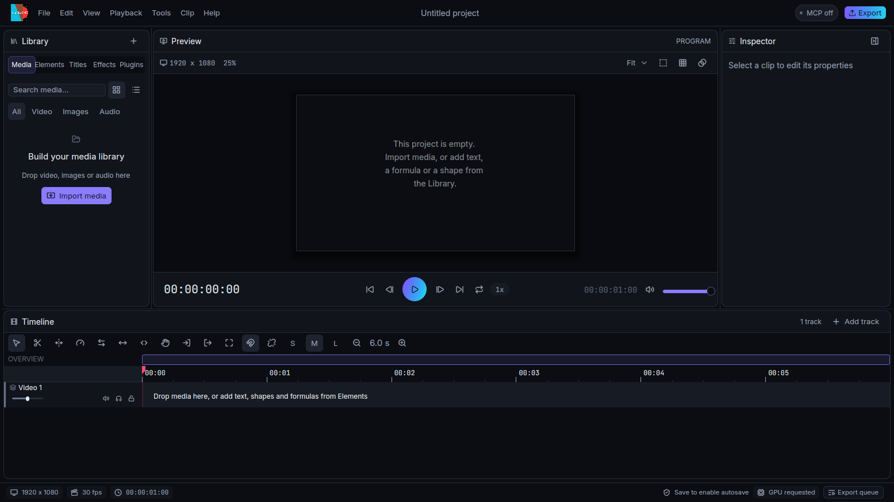

In the inspector, Enter commits a value and returns the keyboard to the timeline (Space plays,
Delete removes clips again); Escape drops an unsaved edit and returns too. In multi-line fields (text content, LaTeX source)
Enter inserts a newline and Escape returns to the timeline; those edits apply as you type. **Help → Editor guide**
opens this page in the browser, **Help → Report an issue** the issue tracker, and **Help → About**
shows the running version.

## Library

The left dock has five distinct tabs. **View → Media / Elements / Titles / Effects /
Plugins** opens the corresponding tab even when the Library is hidden. The existing
Library and Effects focus shortcuts still open Media and Effects respectively.
Arrow keys, Home and End move focus and selection between tabs; Tab continues to
search, cards and buttons. Every tab retains its own search when switching away.
At the default dock width the tabs are icon-only (hover for the name); they show
their labels once the dock is at least 400 px wide. Elements cards flow into two
columns at the default width and three in a wide dock.

| Tab | Contents and actions |
| --- | --- |
| **Media** | Imported assets only. Search names, filter All/Video/Images/Audio, switch grid/list, import using the Library + button, click to place or drag to the timeline. |
| **Elements** | Text & formulas (LaTeX, Text), Shapes & geometry (points, lines, vectors, polygons, circles, ellipses), Graphs & grids (plots, Cartesian and polar grids). Click a card or press Enter/Space to configure; + adds defaults; drag its preview to the timeline. More shapes retains the generic Shapes source for rectangles, stars and arrows. Third-party clip sources appear under Plugins in this tab. |
| **Titles** | Title compositions and caption presets. Double-click or Enter/Space adds at the playhead; drag to place on the timeline. Linked text fields remain editable in the inspector. |
| **Effects** | While no clip is selected a hint says to select one first. Video effects (including Clipped slide), audio effects, one-second transitions/fades, animation presets grouped by In/Out/Emphasis, and Write on for a selected LaTeX clip. Effects still drag onto clips; clicking or Enter/Space applies to the selection. Transition buttons apply to selected clips. |
| **Plugins** | Installed first-party and community plugins, the Community plugins switch, live Enable/Remove controls, Install from file (the + button), and Browse with search, verified installs and explicit updates. First-party plugins stay enabled. Load failures are listed here too. |

Animation presets read the **Preset options** row above their buttons (inspector →
Animations, and the top of Effects → Animations): click an option such as Direction (left,
right, top, bottom), Mask each character or Easing to cycle it, then apply the preset. The
choice applies to every preset that has that option. **Clipped slide In/Out** works on any
clip and slides it from its own edge, hidden outside its bounds; **Character slide In/Out**
does the same for text one character at a time, keeping the wrapped layout. Clipped slide adds a Clipped slide effect to the clip (Effects → Video effects; its
direction, progress and clip parameters stay editable in the inspector); Character slide
animates the text clip's own Character slide parameters instead. Both apply in one undoable
step. An option button reads "default" until you pick a value, so each preset keeps its own
default (an entrance slides in from the left, an exit leaves to the right).

Media filters and view controls appear only on Media. Generated clips have one
creation home in Elements; Plugins lists their installation metadata. See the
[1.x feature map](migrating-from-v1.md#where-1x-features-live) for older workflows
and the separately tracked gaps.

| Media | Elements |
| --- | --- |
| 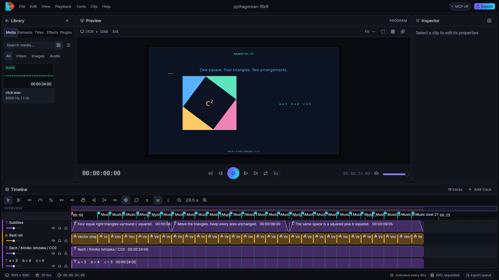 | 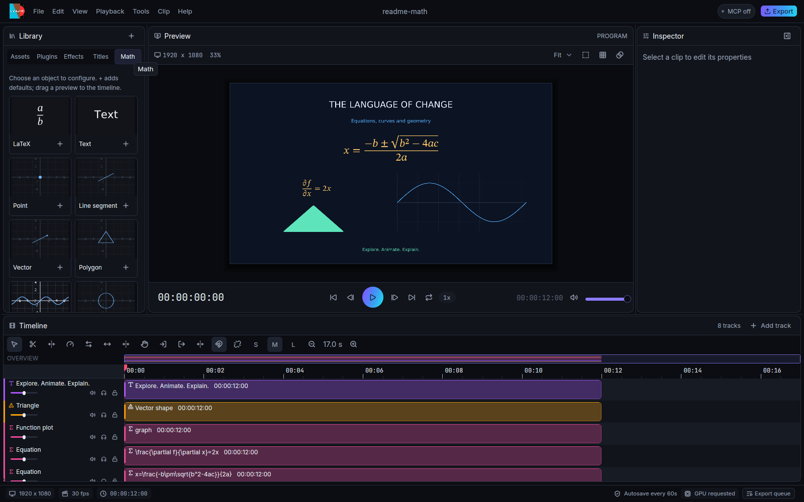 |

| Titles | Effects |
| --- | --- |
| 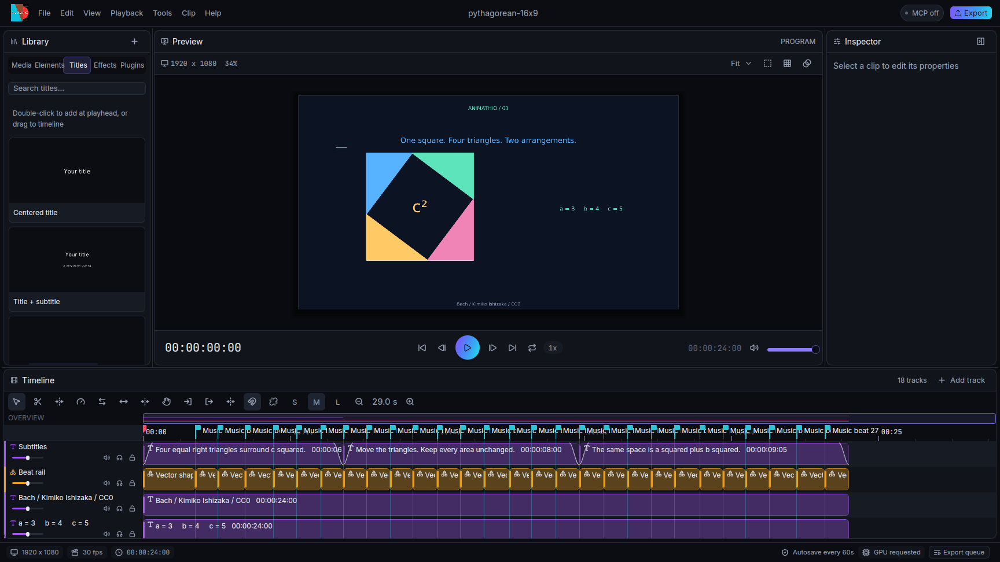 | 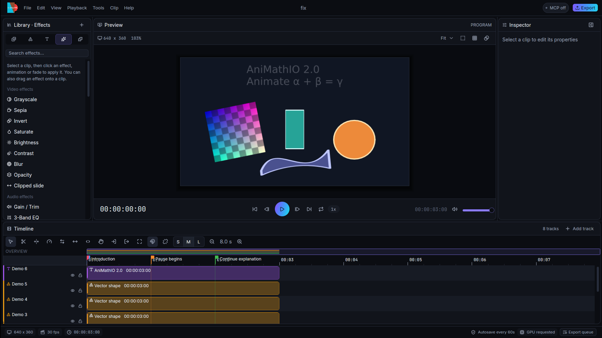 |

### Small windows (1280 × 720)

1280 × 720 is the smallest supported window. The launcher, the Add math object dialog and the
Library are laid out so that their key controls are visible there without scrolling:

| Launcher | Add math object | Library |
| --- | --- | --- |
| 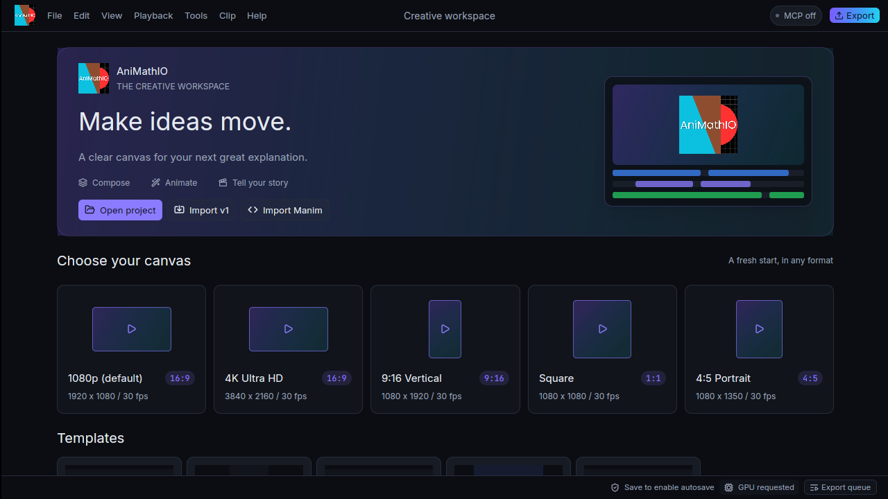 | 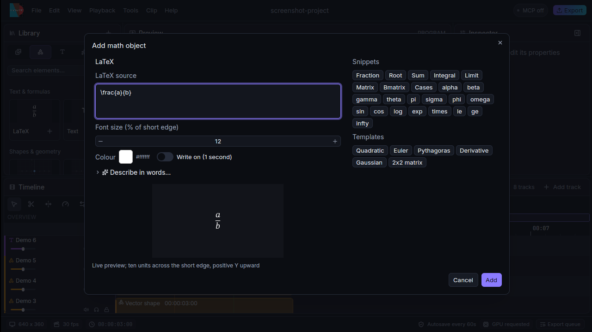 | 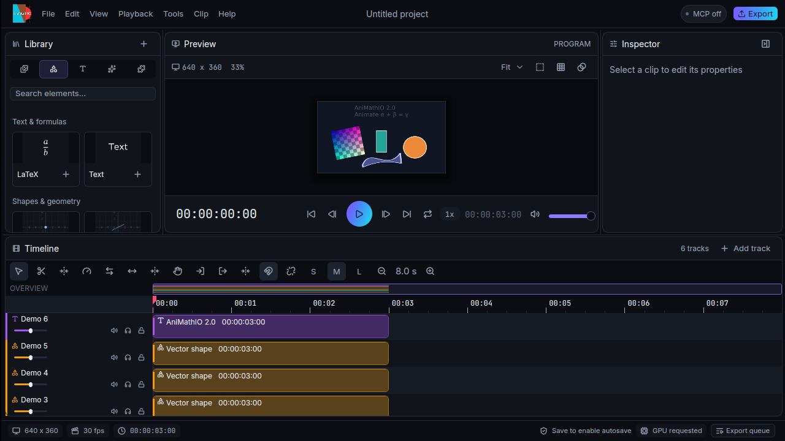 |

### Community plugins

Open **Library → Plugins**. Community plugins start off. This is the only place the switch
lives (Preferences reports its state and links here). A permanent caption under it reads
"Third-party · sandboxed · not audited": community plugins run sandboxed with memory and time
limits and are not audited by AniMathIO. While the switch is off only the first-party plugins
are listed; turning it on adds a trust card and the **Installed** and **Browse** tabs.

**Installed** lists bundled plugins (always enabled) and installed community plugins.
Community cards match the first-party ones (icon, name, version, id, kinds, author, Source
link). Turn the **Enabled** switch on to load an installed plugin, or off to unload it.
**Remove** (red) asks for confirmation, then deletes the community bundle. These actions update the preview without restarting;
project clips retain their plugin reference and show a placeholder while it is missing.
A missing-plugin notice above the workspace names the ids and opens plugin management;
a matching fetched registry entry also offers **Install**.

**Browse** is available only while the community switch is on. Click it to fetch the
community index in the background. Search matches names, authors, ids and descriptions.
Cards show version, licence, minimum ABI, compatibility and a source link. **Install**
downloads the indexed release and checks its size, SHA-256 and package metadata before
saving it. A fresh installation starts disabled: choose Enable on its Browse card or in Installed.
An incompatible plugin stays visible with a reason and its Install control disabled.
Network failures show a Retry action and keep installed plugins usable.

Browse also offers **Update available** when the latest indexed version is newer than
an installed version. Updates require a click and preserve the enabled setting. A
delisted installed plugin shows the registry's reason and is never removed silently.
**Install** is the primary button on a Browse card; after a registry install the card shows
"SHA-256 verified". The **+** at the top of the Library, while the Plugins tab is open,
picks a local `.amplugin` bundle with the native file picker; local files are validated but
have no registry checksum to compare.

The flow with the live registry, step by step:

| 1. Switch off (caption only) | 2. Switch on (trust card, tabs) | 3. Browse (live index) |
| --- | --- | --- |
| 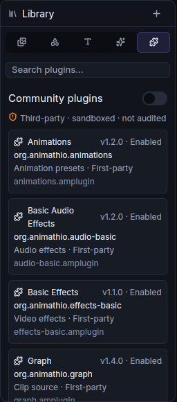 | 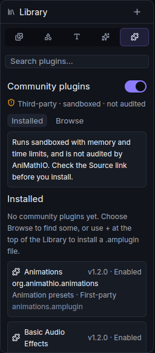 | 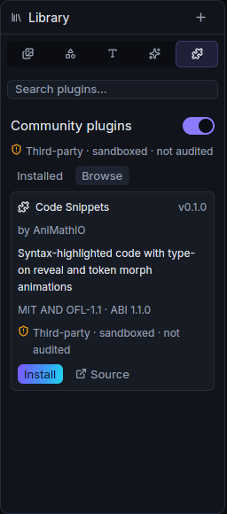 |

| 4. Installed, SHA-256 verified | 5. Enabled |
| --- | --- |
| 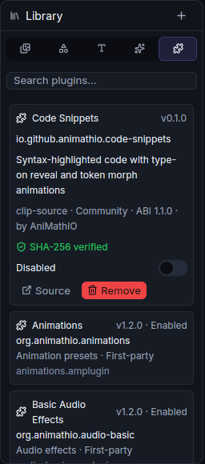 | 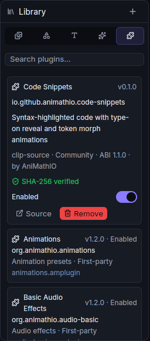 |

Before and after the reorganization (2.1.0 on the left of each pair, same sample
project, release builds with the first-party plugins on a private Xvfb display):

| 2.1.0 Assets | Media | 2.1.0 Math | Elements |
| --- | --- | --- | --- |
| 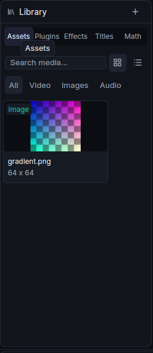 | 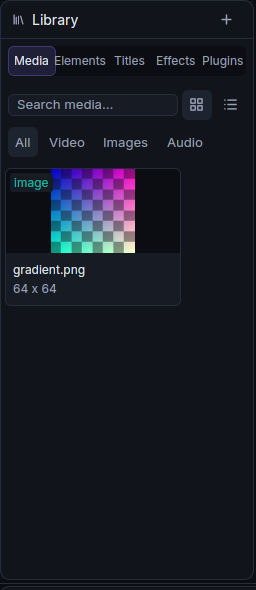 | 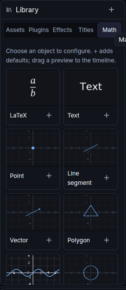 | 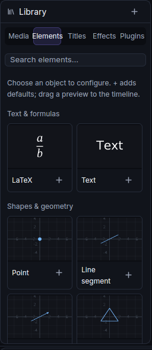 |

| 2.1.0 Plugins | Plugins | 2.1.0 Effects | Effects |
| --- | --- | --- | --- |
| 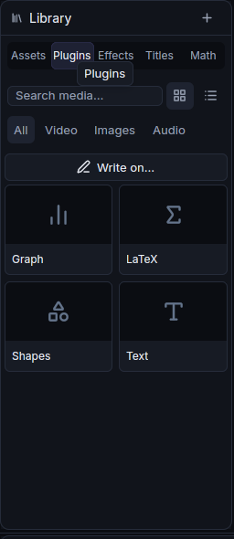 | 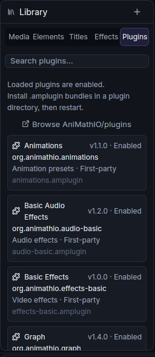 | 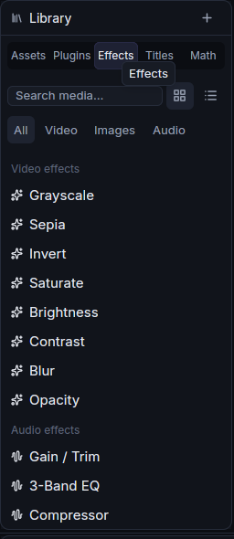 | 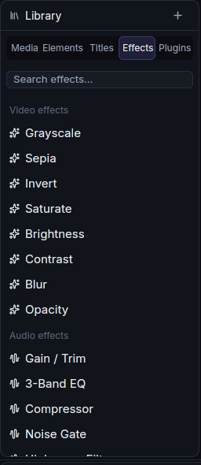 |

| 2.1.0 Titles | Titles | Elements, scrolled | Effects, scrolled to transitions |
| --- | --- | --- | --- |
| 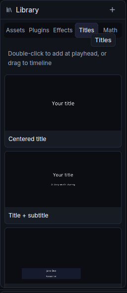 | 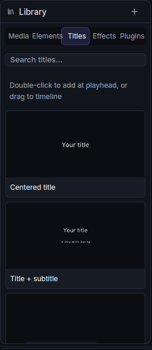 | 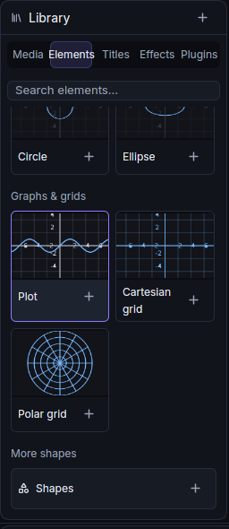 | 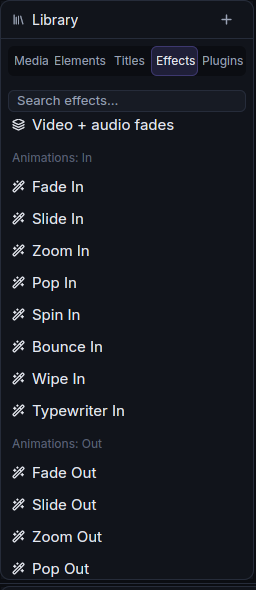 |

## Clip speed and frame holds

Select a clip and open **Clip → Speed/Duration…** (Ctrl+R in the timeline), or the
inspector's **Speed** section. Set 6.25–1600%, reverse, duration in project frames,
or linear ramp keys (`frame:percent, frame:percent`). Source ranges stay fixed;
linked audio follows. **Maintain pitch**, next to Speed/Duration in the inspector
and in the dialog, preserves audio pitch while changing speed (including ramps
and reverse). It is on for new clips; turn it off for pitch-shifting varispeed.
Older projects (before schema 8) retain their previous sound with the option off. Basic time
stretching can soften transients or produce artifacts at extreme rates. Optional ripple shifts
trailing clips on unlocked tracks; without ripple, overlapping results fail.
**Insert frame hold segment…** splits at the playhead and inserts a held picture
with silent companion audio as one undo step. CLI: `animathio-cli set-clip-speed`
and `animathio-cli freeze-frame`; MCP: `set_clip_speed` and `freeze_frame`.
CLI speed edits accept `--maintain-pitch true` or `--maintain-pitch false`; MCP
accepts `maintain_pitch`. Omission keeps the clip setting. Shuttle playback still
changes pitch with transport speed.
Select a clip to see its 100% guide on the timeline, and with ramp keys its speed curve:
drag a square handle to change a key's time and speed (one undo step per drag), Alt-click
a handle to remove it, Alt-click the clip or press **Add speed key at playhead** in the
inspector to add a key. Pressing a clip edge always trims, so a key sitting right on an
edge is changed from the Speed/Duration dialog. Video above 1x speed is filtered over time
(frames averaged across each output frame) instead of dropping frames.
See [retiming rules and limits](architecture.md#clip-retiming).

## Auto-reframe

**Clip, Auto reframe…** follows motion and visual contrast in selected video clips
(or all videos when none are selected). Choose 9:16, 1:1 or 4:5 and tracking
smoothness, then Reframe. Progress and Cancel run alongside the editor. No models
or downloads are needed. The canvas changes in place; video position/scale keys
are replaced in one undo step. Other layers retain their normalized transforms.
CLI: `animathio-cli reframe landscape.amio -o vertical.amio --aspect 9:16`.
MCP `auto_reframe` provides the same operation. See [limitations](mcp.md#auto-reframe).

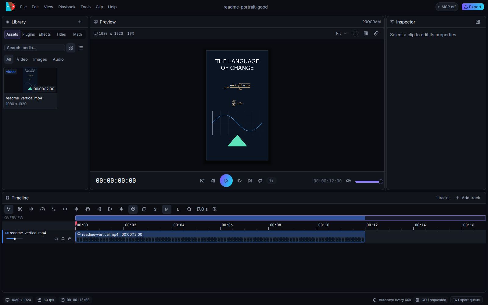

## Automatic subtitles

CapCut-style captions, fully local: **Clip, Generate subtitles…** transcribes the project's
audio (or the selected clip, or the in/out range) with Whisper and adds the result as
caption-bar clips on a new `Subtitles` track, as one undo step; progress and cancel live in
a status-bar popover like the export queue. `animathio-cli transcribe talk.mp4 --srt
talk.srt`, the `auto_subtitles` / `export_subtitles` / `import_subtitles` MCP tools and SRT
or WebVTT import and export work the same way.

Captions can be animated CapCut-style from Whisper's per-word timings: **Classic bar**,
**Word highlight**, **Karaoke fill**, **Pop**, **One word at a time** and **Bold outline**
(big type with a thick outline, centred for 9:16). Pick one in the Generate dialog, or in the
inspector of a selected caption (it restyles every caption on the track as one undo step; font
size, colours, top/middle/bottom position and words per line included). On the command line
use `transcribe lesson.amio --style karaoke -o out.amio`; over MCP pass `style` to
`auto_subtitles` or call `set_caption_style` on existing captions.

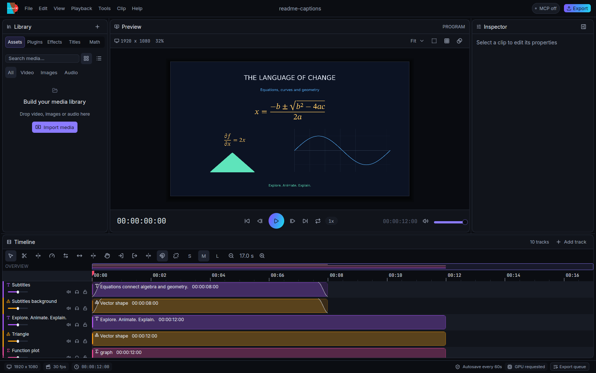

The speech engine is whisper.cpp, built only with `--features whisper` on `animathio`
and `animathio-cli` (needs cmake, a C++ compiler and libclang). No model ships with
the app: pick `tiny` (78 MB), `base` (148 MB, default) or
`small` (488 MB) and AniMathIO downloads it once on your confirmation, verifies its SHA-256 and
stores it in the user data directory. The opt-in integration test runs the real tiny model:
`cargo test -p animathio-transcribe --features whisper --test whisper_tiny -- --ignored`.

## Describe a formula in words (optional AI assist)

The **LaTeX** math dialog (Library, Math, LaTeX; also the inspector of a LaTeX clip) has an
optional **Describe in words…** section (collapsed by default so the LaTeX form fits at
1280 x 720; open it with its header and it stays open for the rest of the session): type "the integral of x squared from 0 to 1", press
**Convert to LaTeX**, and the model's answer replaces the formula field. The live preview
renders it through the LaTeX plugin, so a reply that does not compile is flagged there and
**Add** stays disabled until you fix it. You can edit the LaTeX freely; **Add** inserts it as
one undo step, exactly like typing LaTeX. Everything else about LaTeX authoring (snippets,
templates, source editing) works offline and unchanged; this box is simply off until you set
it up.

**Setup.** Press **Set up** in the box (it is open on first use), pick a starting point and
fill in three things: the base URL of an OpenAI-compatible server, a model name and, for online
services, an API key.

| Service | Base URL | Model (example) | Key |
| --- | --- | --- | --- |
| OpenAI | `https://api.openai.com/v1` | `gpt-4.1-mini` | an OpenAI API key |
| Google Gemini | `https://generativelanguage.googleapis.com/v1beta/openai` | `gemini-2.5-flash` | a Gemini API key from Google AI Studio |
| Ollama (offline) | `http://localhost:11434/v1` | a model you pulled, e.g. `llama3.2` | none |
| llama.cpp `llama-server` (offline) | `http://localhost:8080/v1` | `default` | none |

Model names change often; use whatever your provider currently offers. Remote servers must use
`https://`; plain `http://` is accepted only for `localhost`, `.local` names and private
network addresses, so text never crosses the internet unencrypted. A key is never sent or
stored for a plain `http://` server unless it is on your own machine (`localhost`,
`127.0.0.1`, `::1`): for a network server that needs a key, use `https://`. A full
`.../chat/completions` URL works too. Press **Save**; leaving the fields empty and saving turns
the feature off again.

**Where things are stored.** The base URL and model are in `assist.json` in the editor
configuration directory (next to `recent.json`). The API key is **never** written there, nor to
projects, logs or error messages: it goes to the operating system keyring (Secret Service /
GNOME Keyring / KWallet on Linux, Windows Credential Manager, macOS Keychain; inside Flatpak the
Secret portal) under an entry for the server's origin (scheme, host and port), so changing the
base URL never sends one service's key to another, not even the `http` and `https` versions
of the same address. **Remove saved key** deletes it. The keyring is only asked when you open
**Set up**, press **Save** or **Convert to LaTeX**, never just by opening the dialog. A working
keyring backend is required for keys: GNOME Keyring or KWallet (Secret Service) on Linux, and
inside Flatpak a Secret portal backend on the host (GNOME Keyring or KWallet with its portal).
Without one, **Set up** shows "Keyring not available" and a key cannot be saved; online
services then answer with a rejected-key error. Local servers need no key anyway.

**Data flow and privacy.** Nothing is sent when you open the dialog, type, or save the setup.
Only pressing **Convert to LaTeX** sends one HTTPS (or local) `POST` to
`<base URL>/chat/completions` containing a fixed instruction asking for LaTeX only, the model
name and the text in the description box. No project data, file names, media or other clips are
included. A one-line notice under the box names the host the text goes to and whether a key is
sent. The conversion runs on a background worker; **Cancel** closes the connection at once
and discards the answer, requests time out after 60 seconds and redirects are not followed.
Failures are reported in words (HTTP status, rejected key, timeout, unreachable server, a reply
that is not a chat completion, or a reply that is not LaTeX). The text you send is handled
under the provider's own terms; choose a local server when it must stay on your machine.

The integration lives in its own crate (`animathio-assist`), not in the core and not in a
plugin (plugins are sandboxed without network access). The command line and the MCP server make
no AI requests; they keep taking LaTeX directly.

## Editor gallery

The editor shell (dark theme, Media library, viewer
with transport controls, resizable inspector and vertically scrolling timeline;
the screenshots of this view and of the timeline are current, while some other
gallery images below predate the Library reorganization and still show the
2.1.0 tab names):

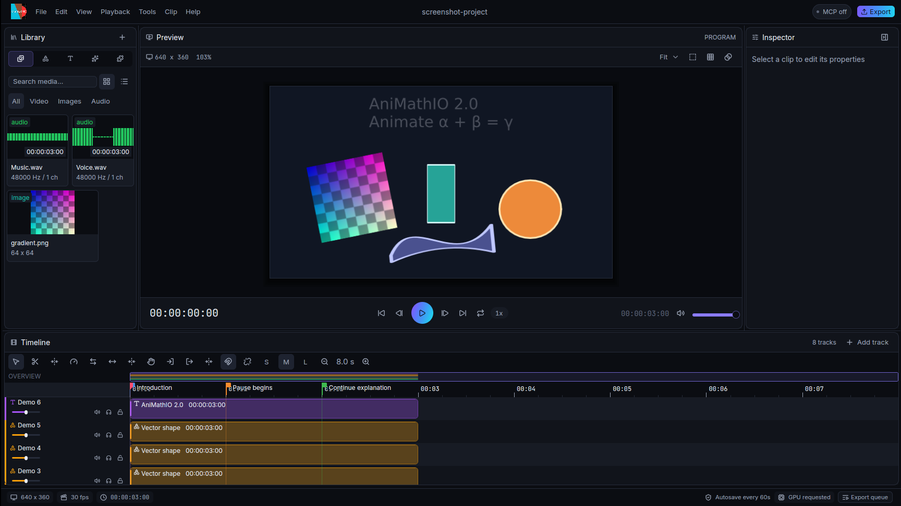

| Start screen | Export |
| --- | --- |
| 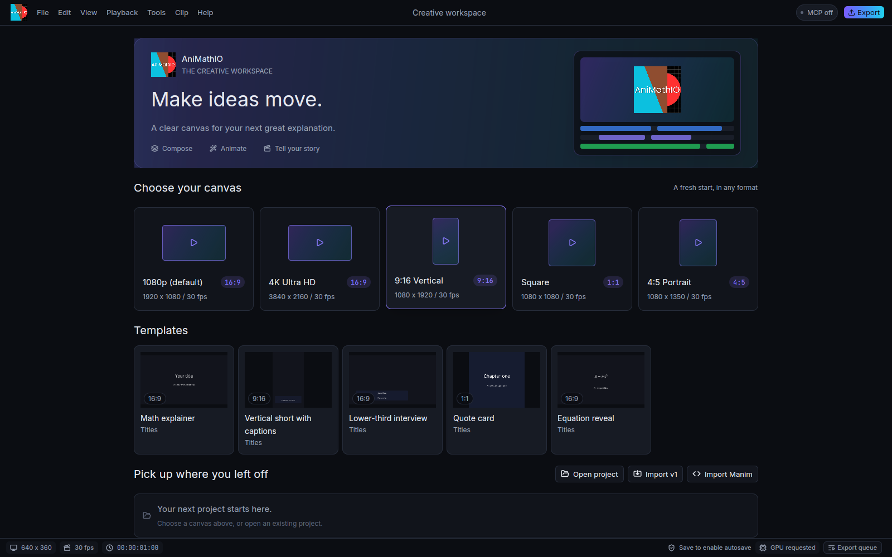 | 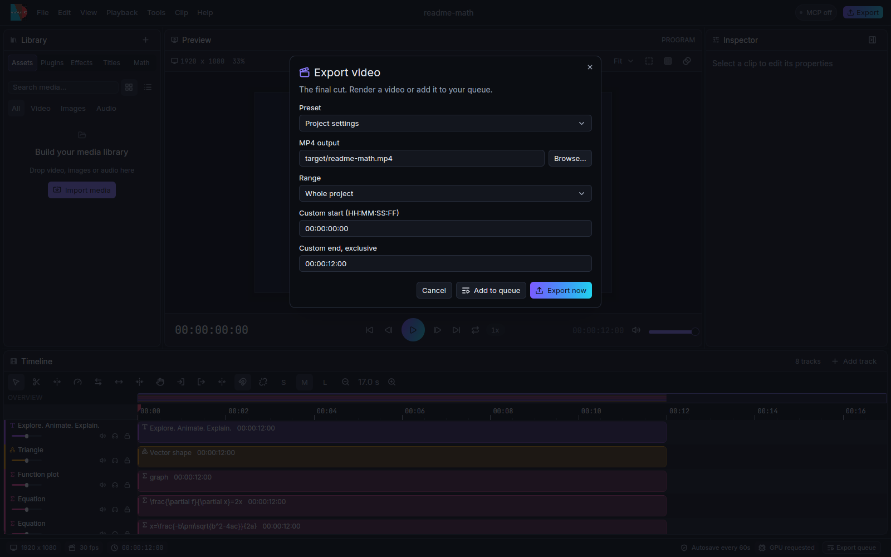 |

| Viewer and inspector | Timeline |
| --- | --- |
| 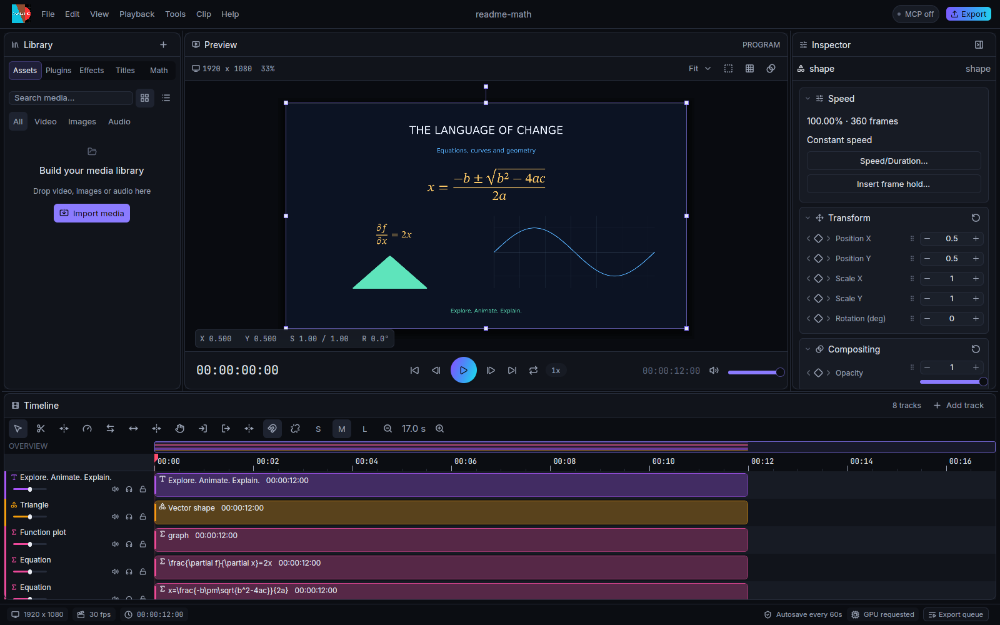 | 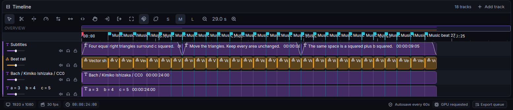 |

| Multi-selection (rubber band, inspector summary) | Media library (thumbnail grid) |
| --- | --- |
| 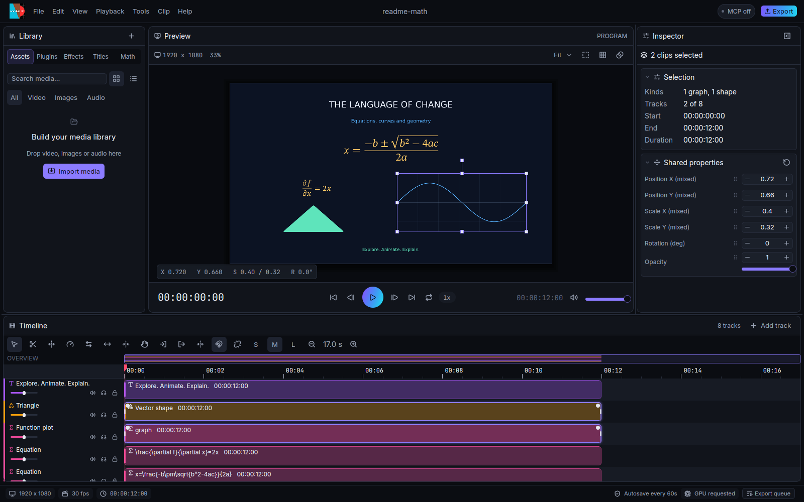 |  |

| Titles library | Export queue (status-bar popover) |
| --- | --- |
|  | 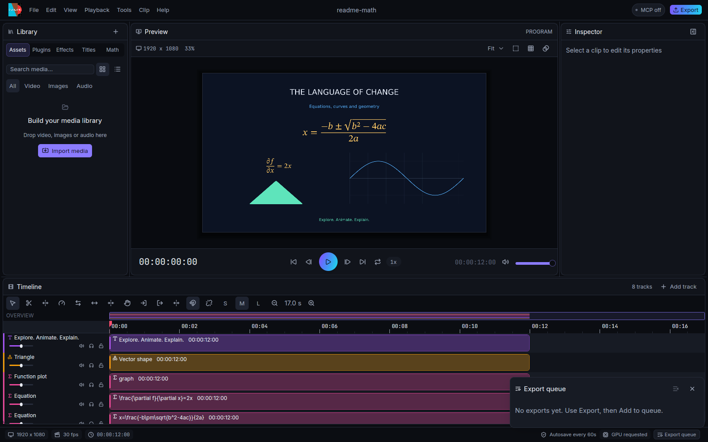 |


| Media fit modes (Fit, Fill, Stretch, 1:1) and the Fit inspector control |
| --- |
| 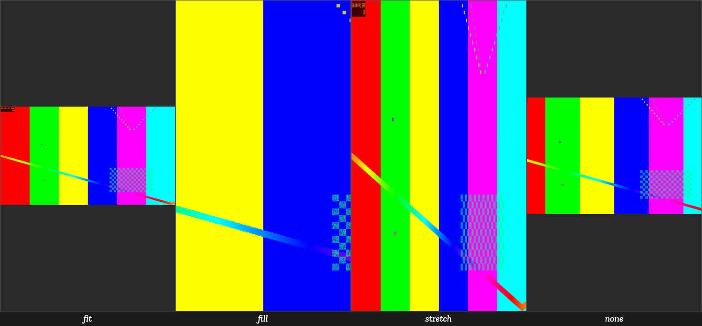 |
| 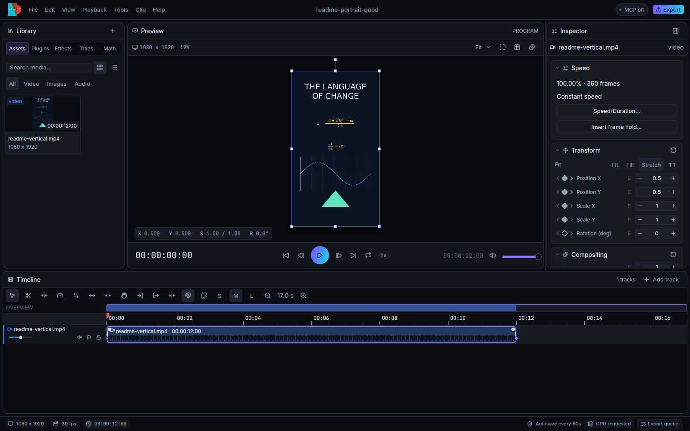 |


The preview renders on the GPU (Vello on wgpu) when an adapter is available and
falls back to the CPU reference otherwise. Toggle it with **View → GPU preview**
(persisted), or force it for one run with `ANIMATHIO_RENDER=cpu` or `ANIMATHIO_RENDER=gpu`.
Export always uses the CPU renderer.

The editor is a thin GPUI shell over the command-only core. Playback, timeline
editing, generated plugin controls and the control socket share the same model.

The title bar provides File/Edit/View/Playback/Tools/Clip/Help menus, project status, the control
socket badge and Export. Drag panel dividers to resize; View toggles panel visibility.
The layout and S/M/L timeline track heights persist between sessions.

Ctrl+Alt+N creates a project (Cmd+Alt+N on macOS). Use Ctrl/Cmd with O/S/I/M
for Open/Save/Import/Export and Z or Shift+Z for Undo/Redo. In the timeline, Ctrl/Cmd+K splits the selected clips at the
playhead and Delete removes the selection; Shift+Delete ripple-deletes it (or the in/out
range across all tracks when no clip is selected). Space, Left/Right, Up/Down
and Home/End control playback, frame stepping, edit-point stepping and project bounds.
J/K/L shuttle backward/stop/forward; repeated J/L doubles the speed up to 16x. Holding K
while pressing J or L jogs at half speed. Audio follows the shuttle and stays the master
clock: forward 1x/2x/4x/8x and reverse 1x/2x/4x are audible (varispeed, so pitch follows
speed); faster rates are muted while video keeps pace.

**Selection and clipboard.** Click selects a clip; Ctrl/Cmd+click toggles it, Shift+click
adds the clips between it and the last-selected clip on the same track, and dragging a
rubber band over empty track space (Shift/Ctrl extends the selection) selects every
clip it touches. Ctrl/Cmd+A selects all, Esc clears (and first cancels a drag, menu or
rename). The inspector shows the clip count, kinds, tracks and time span, and its
Transform fields (plus Gain for all-audio selections) edit every selected clip at once.
Dragging, nudging (Alt+Left/Right = 1 frame), deleting and splitting act on the
whole selection as one undo step. Ctrl/Cmd+C/X copy/cut, Ctrl/Cmd+V pastes at the playhead
on the original tracks (a missing, locked or occupied track gets a new one, so a paste
never overwrites), and Ctrl/Cmd+Shift+/ duplicates the selection right after itself. The clip
JSON is also written to the system clipboard, so it can be pasted into another project
window.

**Context menus.** Right-clicking a clip, track header or keyframe opens a menu whose items
show their real keyboard shortcut (the same bindings as the menu bar and Help > Keyboard
shortcuts), for example Cut, Copy, Duplicate, Split, Delete, Ripple delete and Unlink
(Ctrl/Cmd+L also links unlinked selected clips).

**Adding elements.** Text, shapes, LaTeX and graphs from the library (click a card, or drag
it onto the timeline) are overlays: they land on the dropped row or the first free track above
everything they overlap, and a new track is created when none is free, so you never have to
move the playhead past existing media. Track and clip are one undo step. MCP `add_math` and
`add_graph` do the same. Media clicked or dropped from the Media tab follows the same rule: when
the chosen track is busy (or locked) over that time, the clip goes to a free layer (or a new track)
instead of failing, as one undo step. A new formula starts at 14 % of the shorter frame edge, centred, so it reads
the same on 16:9 and 9:16.

**Viewer, inspector and Media library.** The selected visual clip shows an on-canvas
transform gizmo: drag inside to move (snapping to the canvas centre and edges, with
accent guide lines), drag a corner or edge handle to scale (Shift keeps the aspect
ratio), drag the handle above the box to rotate (Shift snaps to 15 degrees). For text, formulas
and shapes the box hugs what the clip draws, not the whole canvas. A small
pill shows the live values. A drag previews without touching the history and lands as
one undo step on release. The viewer header has the zoom menu, safe-area, rule-of-thirds
and checkerboard toggles. The transport shows a large timecode (click it to type one),
prev/next edit, frame step, the circular play button, loop, the shuttle-speed badge,
the duration and a monitor-only volume (it never changes export). Inspector sections are
collapsible cards with a reset button each; text, formulas, shapes and graphs show their own
content first, video leads with Speed and audio with its Audio section (gain, mute, effects), then
Speed. Rotation is shown in degrees with one decimal and font sizes as a percentage of the short
canvas edge, whatever unit the clip stores them in; colors read `#rrggbb` (the alpha byte is added
only when it is not `ff`). Drag a field label (Shift = fine, Ctrl =
coarse) or the grip beside a value to scrub it as one undo step; 0 to 1 parameters also get a slider;
every animatable property (numbers, colors, points) has a keyframe diamond with previous/next-key
arrows; text, choices and switches have none. The
Media tab of the Library offers a grid or list, a search field, kind filter chips, per-card type
badges, duration and resolution, audio waveforms, and hover-scrubbing of video posters.

**Tracks.** Double-click a track name to rename it inline (Enter commits, Esc cancels).
Drag a track header onto another to reorder, or use the header's right-click menu
(Rename, Move up, Move down).

**Ripple.** The toolbar link button (Tools → Ripple all tracks) switches ripple edits
between "this track only" (default) and "all tracks". With all tracks, ripple delete and
Ripple trim (B, or Ctrl+edge-drag) slide later clips on every unlocked track, never into
a neighbouring clip; locked tracks stay put.

I and O set in/out points (out is exclusive), Shift+I/O jumps to them, and Ctrl/Cmd+Shift+X clears them. The ruler highlights
the range; looping uses it and export defaults to it. Select (V), Blade (C), Ripple
trim (B), Rate Stretch (R), Slip (Y), Slide (U), Rolling Edit (N) and Hand/pan (H) are available in the timeline toolbar. Shift+blade-click
splits across tracks; Ctrl+edge-drag also ripple-trims. Ripple trim shifts later clips
on the same track as one undo step. S toggles snapping and an engaged snap draws an
yellow line. The additional edit tools preserve source intervals (Rate Stretch),
shift source in/out (Slip), compensate touching neighbours (Slide) or move a shared
edit point (Rolling Edit). These edge tools also work at the fade-handle corners.
Each drag is one undo step; the floating readout shows
the delta, speed and source timecodes. Equals/minus zooms and backslash fits the timeline.
Shift+Left/Right steps the playhead five frames; Ctrl/Cmd+Shift+K adds edits on all unlocked tracks.
Q and W ripple-trim the previous/next edit to the playhead, Ctrl/Cmd+D applies the default
transition (1 s fades) to the selection, Ctrl/Cmd+Shift+D to audio clips and Shift+D to both,
and Ctrl/Cmd+G groups (links) a multi-selection. The full Premiere-style table lives in
[docs/keyboard-shortcuts.md](keyboard-shortcuts.md).
Ctrl/Cmd+wheel smoothly zooms around the pointer; drag the overview above the
tracks to scroll. Clips show kind colours, video/image filmstrips, filled audio
waveforms, content snippets, smooth fade curves and gradient transition windows. Select a
clip to show its keyframe diamonds. Tracks that carry sound have mute/solo/lock buttons and
a horizontal gain slider (drag to adjust, double-click to reset to unity); a drag
is one undo step. Tracks of text, formulas, shapes and images get a lock button and an eye
toggle (hide the track) instead. The S/M/L group in the timeline toolbar sets the track height; use
large tracks for the most detailed clip previews. In a window shorter than 800 px the timeline
drops its overview strip, the transport gets slimmer, and a first run (no saved layout) starts
with small tracks. Library, Inspector and Timeline show a thin scrollbar whenever they overflow;
when the Library is too narrow for tab labels, its header names the active tab.

Export opens a form with an MP4 path chooser, whole/in-out/custom range and shared
`youtube_1080p`, `youtube_4k`, `shorts_vertical`, `square` and `portrait` presets (30 fps, CRF 18).
Presets apply to an export snapshot, keeping project settings unchanged. Existing
files require confirmation. Exports never block the editor: "Add to queue" or "Export now"
snapshots the project into a job, and the Export queue popover (status bar, View menu) runs
jobs one at a time with progress, ETA, cancel, show-in-folder/open and error text; toasts
announce completion or failure.
File → Project settings edits resolution, rational fps and background. Preferences
(Ctrl/Cmd+,) saves the preview renderer, autosave interval (0 disables), default export
folder, UI scale, density and reduced motion in the application config directory,
separately from projects. Interface → UI scale defaults to the desktop's text scaling
(KDE forceFontDPI/Xft.dpi, GNOME text-scaling-factor, Windows text-size slider), can be
set to 80–200% in 10% steps and applies live; `ANIMATHIO_UI_SCALE=150` overrides it for
a run.
In custom dialogs, Enter runs the primary action and Escape cancels. Invalid values
keep the form open and show an error inside it. Math source fields accept
Shift+Enter for a new line.

**Import media** (Ctrl/Cmd+I or the library's plus button) adds files to the library
without inserting clips or changing the playhead. Files that cannot be imported are named in
the error message together with the accepted formats (PNG, JPEG, WebP, BMP; WAV, MP3, FLAC, AAC,
M4A, OGG; MP4, MOV, MKV, WebM); the other files in the same selection still import. Drag a library card onto a timeline
track to place it, or click it to add at the playhead. Use **Add track** in the timeline
header to create an empty foreground layer at the top; adding a track is undoable.
Foreground visual tracks appear above background tracks, with audio-only tracks below.
Track headers, drops, selection and reorder gestures use this same display order; the
project file keeps its existing back-to-front layer order. The ruler and marker lane
stay fixed while track rows scroll vertically.
Drop OS media files on the pool to import assets, or on a timeline track to import
and place them at that position. Multiple files are placed consecutively. The Plugins
tab's **Write on…** action replaces a selected LaTeX clip's reveal animation with
0-to-1 keyframes over a chosen duration, in one undo step. Help → Keyboard shortcuts
shows the registered bindings. Text fields support selection, paste and IME.

### Titles and social formats

The library's **Titles** tab offers eight animated compositions (plus the typography presets below): centered title,
title + subtitle, lower third, caption bar, chapter card, end card, kinetic word
pop and math title. Double-click a card to add five seconds at the playhead, or
drag it to a timeline position. The inspector exposes the linked composition's
text fields. All layers move together and insertion undoes in one step.
Thumbnails render on the CPU in the background and are cached per canvas size.
Text/shapes plugins are required; math titles also need the LaTeX plugin.

Below the compositions, a **Typography** section restores the 1.x text styles as ten
single-layer presets: Title, Subtitle, Body, Caption and Heading 1–6. Their sizes are the
1.x pixel sizes (28, 16, 14, 12 and 24/20/18/16/14/12) normalized against a 360-high
canvas, so they scale with the shorter canvas edge. They are set in the bundled Inter
(the text plugin's `font = inter`). Title and Subtitle use weight 600, the headings 800,
Body and Caption 400. Adding one is a single undo step and selects the
text clip; edit its text in the inspector. Select any text clip to change **Font weight**
(100–900, default 400) and **Font** (`dejavu` or `inter`) in the inspector; every change is
an undoable command. With **Font** on `dejavu` (the default), weight 400 is DejaVu Sans and
any other weight switches to Inter, so keyframing the weight of such a clip changes typeface;
choose `inter` for a weight that varies smoothly.

New project (Ctrl/Cmd+Alt+N or the File menu) opens the same canvas chooser as the
launcher. The launcher pins **Open project**, **Import v1** and **Import Manim** in its
hero, so they stay visible in a 1280 × 720 window. Enter accepts the default 1080p 16:9 canvas (1920 × 1080 at 30 fps); choosing
another tile starts that format. The launcher, project settings and export dialog
share 1080p, 4K, 9:16, square and 4:5 choices. MCP clients can use `list_title_presets` and `add_title` with `preset`
and `fields`; see [the control guide](mcp.md#title-preset-library).


Timeline markers and beat sync: press M to drop a coloured marker on the ruler at the
playhead (Shift+M / Ctrl+Shift+M, or Cmd+Shift+M on macOS, jump to the next / previous
marker). Click a flag to select it (Shift/Ctrl-click for several), drag to move the
selection, double-click to edit a name, colour and note, press Delete to remove, the arrow
keys to nudge by a frame, and Ctrl+C / Ctrl+V to copy and paste markers at the playhead
(markers snap, and clips and the playhead snap to markers). Markers ride along with ripple
edits and autocut. Clip > Markers and beat
sync opens a panel that lists the markers, detects the tempo and beats of the project
audio (or the selected clip) offline, adds markers at every beat, every Nth beat or the
downbeats, and snaps the selected clips' cut points to beats and markers or splits
them there, each as one undo step. The same actions are `animathio-cli markers` /
`animathio-cli beats` and MCP `list_markers`, `add_marker`, `remove_marker`,
`detect_beats` and `sync_cuts_to_beats`; `animathio-cli markers chapters`,
`export --chapters` and MCP `export_chapters` write the markers as YouTube / WebVTT /
FFmpeg chapter lists. See the [CLI reference](cli.md#beats) and
[MCP reference](mcp.md#markers-and-beat-sync).


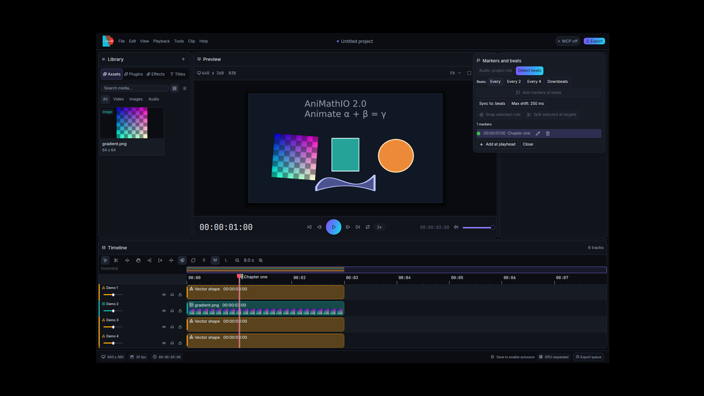

Automatic cuts for recordings are available through Clip > Automatic cuts,
`animathio-cli autocut`, and MCP `propose_autocuts` / `apply_autocuts`. Review silence
ranges on the timeline before applying one undoable linked audio/video ripple edit.
Optional local Whisper adds filler-phrase and immediate-repeat suggestions; see the
[CLI reference](cli.md#autocut) and [review rules](mcp.md#automatic-cut-review).


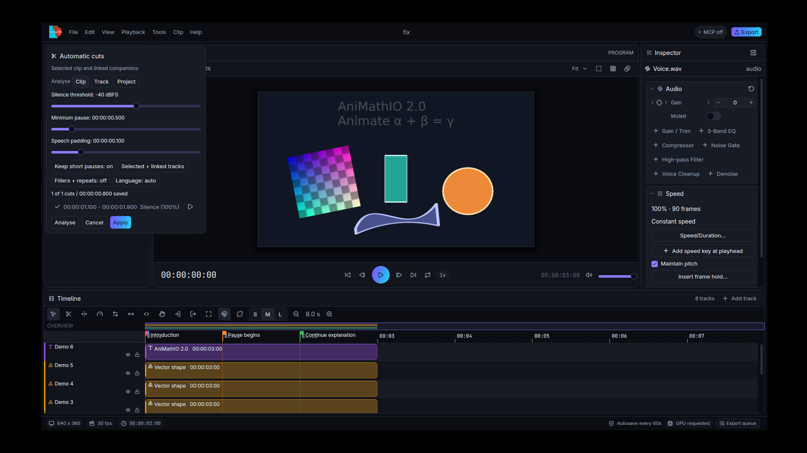

Music ducking under speech is one undoable edit of gain keyframes: Clip > Auto duck…,
`animathio-cli duck`, or MCP `auto_duck`. The panel walks through three steps:

1. **Voice.** Pick the voice tracks, or use the selected clip as the voice (only audio and
   video selections default to it; a selected image never does).
2. **Music.** Pick the music tracks, or individual music clips (each button shows the asset
   name, track name and start timecode, so repeated uses of one asset stay distinguishable).
   When you open the panel with a voice clip selected, every other unlocked audio track is
   suggested as music; untick the ones you want left alone. The voice clip, its own track
   and a video's linked audio are never offered as music, and choosing a different voice
   clip re-suggests the music tracks unless you already picked some.
3. **Preview.** The panel analyses on open and after every change and then says what will
   happen, for example "Music drops by 12.0 dB under 2 voice regions (music lowered for
   2.8 s, ramps included). Writes 6 keyframes on 1 clip as one undo step." The time is
   measured on the music clips only, so it can differ from the voice time. The ducked spans are shaded on the music tracks
   of the timeline, and the play button beside a voice region moves the playhead to where it
   starts. Nothing is written until **Apply**; Edit > Undo then reverts the whole duck.

Depth is a slider; attack, release, minimum gap and voice threshold sit behind the
**Timing and voice threshold** toggle so the preview stays in view. Clips that already have
gain keyframes ask you to tick **Replace existing gain keyframes**. The panel body scrolls (with
a scrollbar) in shorter windows while **Analyse**, **Cancel** and **Apply** stay pinned in a
footer, so the actions are always reachable. See the [CLI reference](cli.md#duck) and
[rules](mcp.md#auto-ducking).

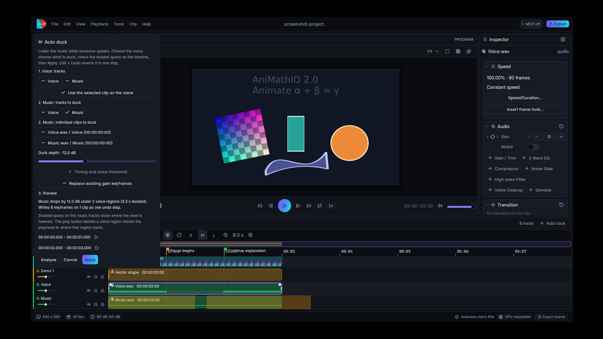

Denoise learns a fixed noise profile from a noise-only selection. Add **Denoise** to an audio
clip, set In and Out around a stretch of room tone (or select one range marker), then choose
Clip > Learn denoise from selection or press **Learn noise from selection** on the Denoise
card. The range is trimmed to the clip, must be 32 ms to 30 s long, and is analysed on the
dry mix; the sixteen band values are stored as plain effect parameters, so the learned profile
is part of the project and the result stays a pure function of it. Learning is one undo step
(undo restores adaptive mode or the previous profile); learn again after changing clip gain. See [rules](mcp.md#auto-ducking) for the shared control API.

In clip and track audio-effect cards, Denoise keeps its sixteen learned noise-band
controls in an **Advanced** section, collapsed initially. Expanding it preserves the
usual parameter editing and keyframe controls.

The launcher lists five bundled project templates and saved user templates, with CPU
thumbnail cards. Creating one opens Fill placeholders for text and picked media;
media supports cover/contain and replacement is one undoable batch. File > Save as
template stores the current project and selected placeholder clips in the user data
library; user cards have Delete. The CLI keeps `templates list` and
`new --template quote -o quote.amio`; MCP adds `list_templates` and
`create_from_template`. Template card hover lifts use the shared surface tokens.

The launcher, editor title bar and application icons use the restored original
AniMathIO logo, preserved in `apps/animathio/assets/brand.svg`. UI actions keep
the violet-to-cyan accent. See [the design guide](design.md).

[Keyboard shortcuts](keyboard-shortcuts.md) — Premiere Pro defaults.

The library's **Elements** tab provides grouped preview cards for LaTeX, text, points, lines,
vectors, polygons, plots, circles, ellipses and Cartesian/polar grids. Click a
card for typed fields and a live preview, use its plus button for defaults, or
drag it onto the timeline. Double-click an existing object to edit it. LaTeX has
snippets, formula templates and a Write on preset. In its dialog, Color and Write on sit
beside the source (above the palette); a window at least 960 px wide puts the Snippets and
Templates palette in a second column, so nothing is below a scroll at 1280 × 720. See the
[math workflow](architecture.md#mathematical-object-workflow) and the
[CLI guide](cli.md) for automation equivalents.


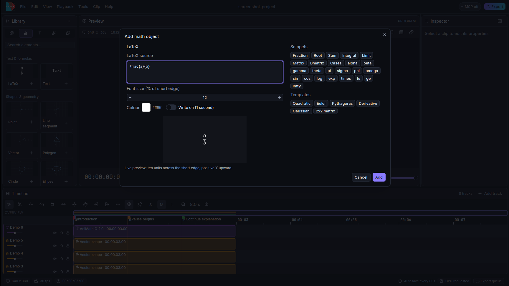

## Reproducible math showcases

[Three short math explainers](../examples/showcase/README.md) exercise the public CLI/MCP
authoring surface, CPU golden frames and H.264/AAC export offline. Each includes
landscape and vertical layouts; the opt-in `scripts/showcase-export.sh` produces
full deliveries using checksum-pinned public-domain recordings.

Scene detection: **Clip → Split at scene changes…** reviews sampled hard cuts with thumbnails and toggles, then splits linked video/audio or adds markers in one undo step. CLI `scenes` and headless MCP expose the same analysis.

## Update notices

Once per day, at startup, the editor asks the GitHub releases API
(`https://api.github.com/repos/AniMathIO/AniMathIO/releases/latest`) whether a newer
2.x release exists. When one does, a toast announces "AniMathIO <version> is
available" with an **Open release page** action that opens the release in your
browser; closing the toast dismisses the notice. Only the release version and page
URL are read: no telemetry is sent, nothing is downloaded automatically, and 1.x
tags and pre-releases never announce. Every network failure is silent (debug-level
log only); failed attempts also count toward the 24-hour limit.

The check never runs in the headless test harness, in benchmark runs and in
CI environments. To turn it off for yourself untick **Check for updates** in
**File → Preferences**, or set the environment variable `ANIMATHIO_NO_UPDATE_CHECK=1`
(any other value keeps it on). The last check time is remembered in the application
config directory (`update-check.json`), so at most one request is made per 24 hours.

## Installer verification

Verify with `animathio --version` and `animathio-cli --version`. The `Package` workflow also
publishes a `SHA256SUMS` artifact covering every installer it built. Download the installers and
that file into the same directory, then check them with:

```bash
sha256sum -c SHA256SUMS
```

Provenance of CI-built installers is attested with `actions/attest-build-provenance`
(`gh attestation verify <file> --repo AniMathIO/AniMathIO`).
