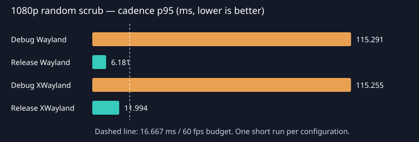

# GPUI viewport risk spike

Measured 2026-11-11 on the shared Linux desktop. Scope: M0 viewport and Sprint 1 of [#156](https://github.com/AniMathIO/AniMathIO/issues/156). This project is deliberately independent of the root workspace.

## Decision

**GO for a Linux GPUI viewport on the tested hardware, using the public CPU-pixel/image path.** Release native Wayland delivered **164.50 fps**, cadence p50/p95 **6.060/6.181 ms**, with **zero** intervals above 16.667 ms across 1,645 samples. XWayland also passed at **156.47 fps**, p95 **11.994 ms**. No GPUI fork or zero-copy integration was needed for this synthetic 1080p workload.

This clears the immediate hosting risk, not the full editor performance budget. Readback and re-upload are avoidable overhead, debug is only about 9 fps, the tested GPU is high end, and there is no Windows or lower-end GPU result. Keep GPUI behind the planned adapter boundary, choose/pin a compatible widget-kit distribution, and recheck with decoded video plus editor UI before committing further. The numbers do **not** justify a Windows GO or claim that shared-device integration is solved. The measured Linux result gives no reason to switch to egui at M0.

## Presentation path implemented

`integer time ticks → Vello Scene → Vello GPU compute → wgpu RGBA8 texture → staging buffer → map/wait → CPU BGRA conversion → RenderImage → GPUI img → Blade/Vulkan → compositor`.

Every frame is actually rasterized at **1920×1080**. The scene has a moving three-stop gradient, 24 animated circles, a rotating rectangle, and font glyphs including the evaluated timestamp. The initial preview requests 1920×1080 logical pixels within a 1960×1280 window. The tested monitor's scale is 1. No reduced-resolution proxy, image codec, encoded PNG, or frame cache is involved.

The staging buffer and Vello renderer/scene are reused. A fresh `RenderImage` replaces the previous image, and `Window::drop_image` evicts the old atlas entry every frame. This is essential: otherwise dynamic image IDs retain approximately 8 MB per frame in the atlas. The pipeline deliberately blocks the UI thread waiting for one readback; there is no producer queue hiding work or dropping requests. Pixel alpha is opaque throughout this scene.

Controls: Play/Pause and a click/drag timeline over ten seconds, plus cadence fps, frame time, and render/readback/convert time. Scrubbing pauses playback and renders the requested tick immediately. Playback uses elapsed integer nanoseconds converted to integer ticks; floating point is used only in drawing and pointer-coordinate conversion. This does not implement the production audio clock or domain model.

## Options investigated

| Option | What was actually tried | Outcome |
| --- | --- | --- |
| Published GPUI native surface/texture APIs | Inspected downloaded `gpui 0.2.2` source (`window.rs`, `platform.rs`, Linux Blade backend). | `Window::paint_surface` is macOS-only and accepts `CVPixelBuffer`. No Linux external-wgpu-texture element/device accessor was found. Not runnable as a public Linux API in this release. |
| CPU pixels in an image element | **Built and ran** Vello/wgpu readback into `RenderImage`, then `img(Arc<RenderImage>)`, on Wayland and X11/XWayland. | Working public API and the measured path. GPUI explicitly expects BGRA bytes, despite accepting `image::Frame`/`RgbaImage`. |
| Sharing the wgpu device with published GPUI | Inspected dependency graph and renderer implementation. | Published GPUI uses **Blade**, while Vello uses **wgpu 30**. They have no shared Rust device type. A Vulkan-native interop adapter would require changes/unsafe synchronization beyond this spike. |
| Current Zed git GPUI | Inspected upstream at [`b6ff193ba604dba841c78cbdee7357f9c420ef9d`](https://github.com/zed-industries/zed/tree/b6ff193ba604dba841c78cbdee7357f9c420ef9d/crates/gpui). Inspected split platform/wgpu crates as well. | Linux does now use wgpu, but the application/window APIs inspected still lack a Linux external-texture paint hook. `WgpuContext` has public device/queue fields internally, while `WgpuRenderer`'s context/core are private; no supported window-to-context accessor was found. `paint_surface` remains Apple-only. Git dependencies would need a matching `gpui_platform` revision too. **Not fetched/built**: avoid compiling a second large GUI graph on the shared machine when it does not expose the needed hook. |
| `vello_cpu` | Not built. | The requested CPU-pixel alternative was exercised through **wgpu readback**. A CPU-only renderer would be a separate experiment and would not establish that the planned wgpu/Vello pipeline can be hosted. |
| Third-party interop forks | Found during API research; not built. | [`gpui_interop`](https://docs.rs/gpui_interop/0.2.1/gpui_interop/) describes same-device `WgpuSurface`/`paint_texture` and Linux dma-buf paths in a different GPUI stack. These are **not APIs of the tested Zed `gpui 0.2.2`**. No zero-copy performance claim is made here. |

Useful upstream source: [published RenderImage](https://docs.rs/gpui/0.2.2/gpui/struct.RenderImage.html), [published Window](https://docs.rs/gpui/0.2.2/gpui/struct.Window.html), [current Window](https://github.com/zed-industries/zed/blob/b6ff193ba604dba841c78cbdee7357f9c420ef9d/crates/gpui/src/window.rs), [current WgpuRenderer](https://github.com/zed-industries/zed/blob/b6ff193ba604dba841c78cbdee7357f9c420ef9d/crates/gpui_wgpu/src/wgpu_renderer.rs), [current WgpuContext](https://github.com/zed-industries/zed/blob/b6ff193ba604dba841c78cbdee7357f9c420ef9d/crates/gpui_wgpu/src/wgpu_context.rs).

## Dependencies and build friction

- The **usable, compiled dependency is crates.io `gpui = "=0.2.2"`**, with one local compatibility patch. `Cargo.lock` pins the full graph; `vello = "=0.12.0"`, wgpu resolves to 30.0.1, image to 0.25.10, skrifa to 0.49.0. GPUI and Vello use separate GPU abstractions/devices.
- Fresh resolution failed at `xattr 0.2.3` (pulled through GPUI utility dependencies): it references `libc::ENOATTR`, removed from current libc 0.2.191 on Linux. `vendor/xattr` preserves upstream source/licenses and changes **only** the Linux/Android alias to `libc::ENODATA` (the equivalent errno). Other platforms keep their existing path. The patch is confined to this Cargo project. Do not remove it without rechecking resolution/build.
- GPUI's default dependency graph is large: the lockfile contains 768 packages before the local patch (including target-specific packages); it brings in image codecs, two graphics stacks, platform libraries and async/network utilities even for this tiny app. The combined debug/check/release target directory reached **5.9 GiB**; the first release build took **4m 31s** at three jobs. That directory is cleaned after the final push.
- No system library was missing; no sudo or package installation was used. Existing fontconfig/freetype, xkbcommon, Wayland, X11 and Vulkan libraries sufficed.
- `cargo clippy --locked -- -D warnings` passed. Cargo emits a future-incompatibility warning about transitive `proc-macro-error2 2.0.1` on Rust 1.99.0; this is a dependency warning, not suppressed in the logs.
- [`gpui-component 0.9.1`](https://crates.io/crates/gpui-component/0.9.1) was downloaded/inspected with `cargo info`. It now belongs to GPUI Kit and pins **`gpui-pre = 0.3.12`**. [`gpuikit 0.9.0`](https://crates.io/crates/gpuikit/0.9.0) was likewise downloaded/inspected and depends on **`gpui-unofficial 1.18`** plus its matching platform crate. Neither current widget kit directly matches `gpui 0.2.2`. Neither was compiled or added just to get a button and slider. Choosing a kit therefore also chooses a GPUI distribution/version; this spike makes no compatibility claim about mixing them. Built-in GPUI elements are sufficient for these controls.
- All Cargo invocations used `CARGO_BUILD_JOBS=3 CARGO_PROFILE_DEV_DEBUG=line-tables-only nice -n 19 ionice -c3 cargo ...`. Release was built only after debug validation, for final measurements. No other spike/workspace files were changed.

## Measurement method and limits

`--bench` opens a real compositor-backed window, spends two seconds warming up, then continuously chooses a deterministic xorshift-random tick in the ten-second scene for ten seconds. It prints p50/p95 and closes the app automatically. Random access regenerates the entire image rather than reusing sequential playback frames. Startup/device creation happens before the warmup clock starts. It is a synthetic workload, not a decoder/seek benchmark.

- **Cadence:** wall-clock interval between GPUI `Render::render` entries, including previous frame generation, GPUI layout/image upload/render submission, and event/compositor pacing. Throughput is measured frame count divided by actual measured wall time. Nearest-rank-style percentile indexing is defined in `percentiles` in source.
- **Pipeline:** wall time for scene construction, Vello GPU rendering, GPU completion/readback, CPU copy/channel swap, `RenderImage` creation, and old image eviction. It excludes GPUI's subsequent upload/draw/present.
- These are **application frame-delivery cadence**, not hardware presentation timestamps, scanout timings, or proof of tear-free display. There are no GPU timestamps or presentation-feedback instrumentation. A visible compositor window was run, but no screenshot/pointer interaction was verified with a computer-use tool. Play/pause/drag handling was inspected in source; no manual click-test is claimed.
- Host: AMD Ryzen 7 5800X, 16 logical CPUs, AMD Radeon RX 9070 XT (RADV GFX1201), Vulkan, Mesa 26.2.6-arch3.1; Linux 7.3.3-1-cachyos, KDE Wayland, 3440×1440 at **165 Hz**, scale 1, VRR Automatic. Rust 1.99.0. The driver prints `radv is not a conformant Vulkan implementation, testing use only`; retain that caveat when interpreting results.
- This machine was shared, not isolated or clock-locked. Runtime was also launched at low priority with `nice -n 19 ionice -c3`. This shell starts at niceness -4, so the additive nice invocation yields 15. Shared load, compositor behavior and GPU power state can affect results. One short run per final configuration is a feasibility sample, not a reliability/soak or lower-end-device certification.

## Results

| Build / compositor | fps | Cadence p50 ms | Cadence p95 ms | Pipeline p50 ms | Pipeline p95 ms | Samples | >16.667 ms |
| --- | ---: | ---: | ---: | ---: | ---: | ---: | ---: |
| Debug / Wayland | 8.84 | 109.146 | 115.291 | 68.365 | 73.426 | 90 | 90 |
| Release / Wayland | 164.50 | 6.060 | 6.181 | 2.199 | 2.796 | 1645 | 0 |
| Debug / XWayland | 8.97 | 109.158 | 115.255 | 68.581 | 72.170 | 90 | 90 |
| Release / XWayland | 156.47 | 6.064 | 11.994 | 2.505 | 3.703 | 1565 | 0 |

Both release runs met the 60 fps budget, including p95 and zero observed budget misses. The 165 Hz display limits throughput near 165 fps. Debug failed decisively; unoptimized CPU pixel conversion and GPUI processing dominate. These are untouched default dev optimization levels, with line-table debug info.

Raw benchmark output lives in `results/`. The table uses final runs with compilation stopped. An earlier X11 debug smoke run overlapped Clippy; it was replaced by the uncontended final run above. All four benchmark processes exited successfully and closed their windows. Differences remain subject to shared-machine noise.

## Platform status

**Wayland:** real native Wayland window in the existing KDE session; default GPUI compositor selection prefers non-empty `WAYLAND_DISPLAY`. Auto-closes after benchmarking. No compositor configuration was changed.

**X11:** exercised by removing `WAYLAND_DISPLAY` from the child's environment while leaving `DISPLAY=:0`. This is **XWayland inside KDE Wayland**, not a separate native Xorg login. Native Xorg remains untested.

**Windows:** build and run **untested**. The code uses public GPUI/image/wgpu APIs and no Linux-specific texture handles, but that is not a portability result. Set `VIEWPORT_FONT` to an installed font file; the default font path is Linux-specific. DX12/GPUI presentation, linker/system setup and actual frame cadence need a Windows machine. No Windows target/toolchain/packages were installed.

## Reproduce

See [README.md](README.md) for exact resource-limited build/run/cleanup commands. Keep the benchmark window visible, use the committed lockfile, and record the GPU/backend/driver from stdout. Compare full cadence to the 16.667 ms budget, not the pipeline-only number. Build artifacts are cleaned after pushing as requested.

## gpui-component migration (2026-11-12)

The editor migrated off crates.io `gpui = "=0.2.2"` onto the GPUI distribution
pinned by **gpui-component 0.9.1** (Longbridge / GPUI Kit). `gpui-component`
depends on `gpui-pre = "=0.3.12"`, which is GPUI Kit's maintained fork of Zed's
`gpui 0.2.2` (same `zed-version = "0.2.2"`, so the application API is nearly
identical). The workspace now pins the matching crate family:

- `gpui-pre` (lib name `gpui`) — the core, platform-agnostic API.
- `gpui-pre-platform` (lib `gpui_platform`) — the desktop entry point
  (`gpui_platform::application()`); it in turn pulls `gpui-pre-linux`
  (pure-Rust `x11rb` + `wayland-client` + system `libxkbcommon`) and
  `gpui-pre-wgpu` (Blade is gone; Linux renders through **wgpu 30.0.1**, the
  same wgpu major the Vello spike uses).
- `gpui-component` — the widget kit (Phase 2 redesign; only `init(cx)` is
  called in Phase 1).

### API deltas found during the port

All confirmed by the compiler, none behavioural:

| gpui 0.2.2 | gpui-pre 0.3.12 |
| --- | --- |
| `Application::new().run(…)` | `gpui_platform::application().run(…)` (desktop platform moved out of `gpui`) |
| `on_window_closed(\|cx\| …)` | `on_window_closed(\|cx, _window_id\| …)` |
| `window.focus(&handle)` | `window.focus(&handle, cx)` |
| `Line::paint(origin, height, window, cx)` | `Line::paint(origin, height, TextAlign, Option<Pixels>, window, cx)` |
| `ScrollWheelEvent` / `.on_scroll_wheel` | `ScrollEvent` / `.on_scroll` (modifiers now `event.modifiers.control`) |

`RenderImage::new`, `Window::drop_image`, `img(Arc<RenderImage>)` and
`ObjectFit` are unchanged, so the presentation path compiled as-is.

### xattr patch removed

`gpui 0.2.2` pulled `xattr 0.2.3` (broken against libc 0.2.191). `gpui-pre`
does not depend on `xattr`, so the `vendor/xattr` patch and the
`[patch.crates-io]` entry were deleted after `cargo fetch` re-resolved cleanly.

### Viewport re-verification on gpui-pre

Added `--bench-viewport` to the editor: it renders the shared sample project at
**1920×1080**, warms up for 2 s, then scrubs to a deterministic xorshift tick at
a 60 Hz request cadence for 10 s and prints the p50/p95 cadence of frames that
complete the full path (worker render → BGRA swap → `RenderImage` → `img` upload
→ `drop_image`), then quits.

Release / Wayland: **550 samples, p50 18.182 ms, p95 18.222 ms ≈ 55 fps**.

This is the **whole editor preview pipeline**, not the synthetic GPU-Vello path
from the original spike. Two deliberate differences from the 164 fps result:

1. **The editor rasterizes with `vello_cpu`** (scalar, SIMD disabled via
   `fearless_simd::force_support_fallback` for deterministic golden frames), not
   the GPU Vello + wgpu-readback pipeline the spike benchmarked. Rasterization,
   not the GPUI upload path, dominates.
2. Rendering runs on a background worker with a channel round-trip and a
   `request_animation_frame` pump, adding ~2–3 ms of hand-off latency per frame.

The presentation path itself (`RenderImage` BGRA + `img()` + `Window::drop_image`)
survived the migration unchanged and is not the limiter. Reaching a strict
60 fps at 1080p in the editor needs either SIMD-enabled rasterization (breaks
golden-frame determinism) or a preview resolution proxy; both are deferred.
